# MP Mix Manager 0.4.0 Stable (Liquid) by Dreamworlds Productions (MPlanetarian)

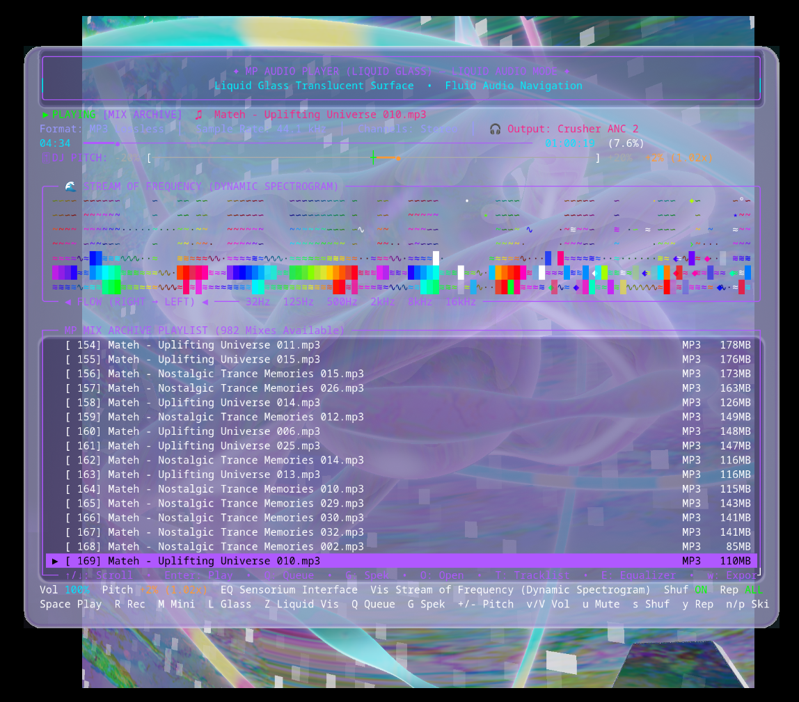

> 📅 **Last Updated:** October 24, 2026 • **Latest Release:** `v0.4.0 Stable`

[]()
[](VERSION)
[](MP_Audio_Player_Liquid_Glass_OpenGL.py)
[](MP_Liquid_Visualizer.py)
[](docs/TRAKTOR_KONTROL_S4_USER_GUIDE.md)
[](README.md)
[]()
[]()
[]()
[]()
[]()
[](MP_Audio_Player.py)
[](mix_web_companion.py)
[](scripts/manage_harmony_agent.sh)
[](mp_report_generator.py)
[-FF5722.svg)](mplanetarians-alarm-clock/README.md)
[](Congen/README.md)
[](LICENSE)

An enterprise-grade workstation orchestration console and media management suite designed for high-resolution audio production, multi-hour DJ mix archiving, automated 32-bit FLAC mastering, 31,000+ track SMB network streaming, Traktor Pro playlist extraction, live tracklist tracking, YouTube & AI Talking-Head video synthesis, automated multi-period intelligence reporting, system maintenance, and AI workflow control across **Linux (Bazzite / SteamOS / Fedora / Ubuntu)**, **macOS (Latest Sequoia / Sonoma, Apple Silicon M1–M4 & Intel)**, **Microsoft Windows 10 & 11**, and **FreeBSD (14.x / 15-CURRENT)**.

> [!TIP]
> ### 🌟 Welcome to MP Mix Manager v0.4.0 — The Ultimate Audio & Visual Workstation!
> **Download & Experience v0.4.0 Now!** Step into the future of high-fidelity music listening, DJ mix management, and visual artistry with our two flagship additions:
> - 🪟 **[MP Liquid Glass Player](MP_Audio_Player_Liquid_Glass_OpenGL.py):** A translucent, still-water glass desktop music player with dynamic light refraction and an **86% slimmer bezel border**. Powered by high-compatibility **OpenGL Core 3.3+**, **Vulkan 1.x**, and **Apple Silicon Metal (M1–M4)**, featuring Windows 10 & 11 DWM acrylic blur, double-click bezel maximize/restore, multi-monitor awareness, continuous playback across manager exit, and in-place Mini/Micro modes (`M` key).
> - 🔮 **[MP Liquid Visualizer](MP_Liquid_Visualizer.py):** A stunning 1400x1400 borderless Vulkan 3D audio-reactive raymarching engine with **zero text overlay**. Continually animates to your music via real-time 24-band FFT telemetry, freezes instantly on pause/stop, and showcases 5 procedural Bandcamp-inspired presets (*Cosmic Dreamworlds Liquid*, *Orbital Void Reflux*, *Dreamworlds Ultra Defasten Biomech*, *Infinite Complexity*, and *Sensorium Interface*).
>
> **👉 [Quick Start by OS](#-quick-start-by-operating-system) • [Download & Try v0.4.0 Today!](#-download--experience-v040-stable) • [Read the Full Changelog](CHANGELOG.md)**

---

## 📑 Table of Contents

- [🎉 Download & Experience v0.4.0 Stable](#-download--experience-v040-stable)
- [🚀 What's New in v0.4.0 Stable](#-whats-new-in-v040-stable)
- [🔥 Core v0.4 Architecture Highlights](#-core-v04-architecture-highlights)
- [🪟 Spotlight: MP Liquid Glass Audio Player (OpenGL • Vulkan • Apple Silicon Metal)](#-spotlight-mp-liquid-glass-audio-player-opengl--vulkan--apple-silicon-metal)
- [🔮 Spotlight: MP Liquid Visualizer (Native Vulkan 3D Audio-Reactive Raymarching)](#-spotlight-mp-liquid-visualizer-native-vulkan-3d-audio-reactive-raymarching)
- [🌌 MPlanetarian Dreamworlds & TUI Navigation](#-spotlight-mplanetarian-dreamworlds--tui-navigation)
- [🎧 MP Audio Player (Terminal Audio Suite)](#-spotlight-mp-audio-player-terminal-audio-suite)
- [📱 DJ Booth & Studio Mobile Web Companion](#-spotlight-dj-booth--studio-mobile-web-companion)
- [🎬 YouTube Shorts 1080x1920 Promotional Video Generator](#-spotlight-youtube-shorts-1080x1920-promotional-video-generator)
- [🎥 Screencast YouTube Video Generator with NVENC & Image Transitions](#-spotlight-screencast-youtube-video-generator-with-nvenc--image-transitions)
- [🤖 Next-Gen AI Orchestration Suite](#-spotlight-next-gen-ai-orchestration-suite)
- [📱 Congen v1.1 by Dreamworlds Productions (MPlanetarian)](#-spotlight-congen-v100-by-dreamworlds-productions-mplanetarian)
- [✂️ Auto-Split DJ Mixes & Multi-Part Spek Spectrograms](#️-spotlight-auto-split-dj-mixes--multi-part-spek-spectrograms)
- [⏰ MPlanetarians Alarm Clock (Wake Up Edition)](#-spotlight-mplanetarians-alarm-clock-wake-up-edition)
- [⚡ Traktor History Harmonic Playlist & Stage Setup](#-spotlight-traktor-history-harmonic-playlist--stage-setup)
- [🎛️ EBU R128 Loudness Mastering, Audio Audit & CUE Engine](#️-spotlight-ebu-r128-loudness-mastering-audio-audit--cue-engine)
- [🔍 Audio Fingerprinting, Chapters & Rekordbox Export](#-spotlight-audio-fingerprinting-chapters--rekordbox-export)
- [🖥️ KDE Plasma Desktop Shortcuts & Global Keyboard Binder](#️-spotlight-kde-plasma-desktop-shortcuts--global-keyboard-binder)
- [📢 Unified Multi-Channel Notification Dispatcher](#-spotlight-unified-multi-channel-notification-dispatcher)
- [🚀 Quick Start by Operating System](#-quick-start-by-operating-system)
- [🎛️ Master Feature Matrix (3 Sections, Options 0–37)](#️-master-feature-matrix-3-sections-options-037)
- [💻 Command Line Interface & Direct Shortcuts](#-command-line-interface--direct-shortcuts)
- [📂 Repository & Codebase Layout](#-repository--codebase-layout)
- [⚙️ Configuration Guide (`config.env`)](#️-configuration-guide-configenv)
- [🧪 Automated Test Suite & Quality Assurance](#-automated-test-suite--quality-assurance)
- [📜 License](#-license)

---

## 🎉 Download & Experience v0.4.0 Stable

> [!TIP]
> ### 🚀 Ready to Experience the Future of High-Resolution Desktop Audio?
> **MP Mix Manager v0.4.0 Stable** is officially here! Whether you are a DJ archiving 4-hour live sets in 32-bit lossless FLAC, an audiophile streaming 31,000+ tracks over SMB, or an electronic music producer craving mesmerizing audio-reactive visuals, v0.4.0 is engineered for you.
>
> 💎 **Top 5 Reasons to Download & Run v0.4.0 Today:**
> 1. 🪟 **MP Liquid Glass Audio Player:** Unmatched desktop beauty with real-time still-water refraction, dynamic caustics, and an **86% slimmer bezel border**, running across **OpenGL Core 3.3+**, **Vulkan 1.x**, and **Apple Silicon Metal** with Windows 10 & 11 DWM acrylic blur.
> 2. 🔮 **MP Liquid Visualizer:** Jaw-dropping **1400x1400 borderless Vulkan 3D raymarching** with zero text overlay, moving organically to your sound via 24-band FFT telemetry and freezing in-place on pause across 3 Bandcamp presets.
> 3. 🎛️ **10-Band Electronic Music Graphic Equalizer:** Tailored DSP audio curves (*Ambient*, *Trance*, *Techno*, *House*, *Progressive*, *Vapourwave*) with an interactive visual decibel scale HUD (`E` key) and custom preset disk saving (`S` key).
> 4. 🎚️ **Traktor Kontrol S4 Hardware MIDI Studio:** Seamless dual-deck pitch fader control (-20% to +20%) with 0.0% deadband detent snapping and ALSA rawmidi background daemon.
> 5. 💻 **One-Click Native Cross-Platform Launchers:** Double-click `MP_Mix_Manager.exe` or `launch_liquid_glass.bat` on Windows, `manager_macos.command` on macOS, or `./manager.sh` on Linux!
>
> ### ⚡ Quick 3-Step Setup:
> ```bash
> # 1. Clone or download the repository
> git clone https://github.com/mplanetarian/MP_Mix_Manager_v0.4.git
> cd MP_Mix_Manager_v0.4
>
> # 2. Run the automated installer (Linux / macOS / FreeBSD)
> chmod +x install.sh && ./install.sh
>
> # 3. Launch the Master Console (or double-click the desktop shortcut!)
> ./manager.sh
> # On Windows: double-click MP_Mix_Manager.exe or manager.bat
> # On macOS: double-click manager_macos.command
> ```
>
> **🎧 Test Drive the New Features Immediately:**
> - Launch **MP Liquid Glass Player**: Press Option **`3`** on the Main Page, press **`L`** inside MP Audio Player, or run `mix-archive-manager --liquid`.
> - Launch **MP Liquid Visualizer**: Press Option **`23`** ➔ **`2`**, press **`Z`** anywhere in the Manager/Player, or run `mix-archive-manager visualizer`.
> - Switch Visualizer Presets: Press **`[1]`**, **`[2]`**, **`[3]`**, **`[4]`**, or **`[5]`** while the 3D visualizer window is open!

---

## 🚀 What's New in v0.4.0 Stable

> [!IMPORTANT]
> **MP Mix Manager v0.4.0 Release (October 24, 2026):** Introduces the groundbreaking **MP Liquid Glass Audio Player** (OpenGL / Vulkan / Apple Silicon Metal) with 86% slimmer bezels and Windows DWM acrylic blur, the native Vulkan **MP Liquid Visualizer** with real-time 3D audio-reactive raymarching across 5 Bandcamp presets (including the new **Stream of Frequency** and **Sensorium Interface**), the global **Stream of Frequency Theme** and animated spectrogram equalizer (`stream_of_frequency_eq`), free celebratory release track & art piece in **`MP_SAMPLES/`** pre-loaded on first run, updated **`MP_loader.mp4`** startup soundtrack, native **Traktor Kontrol S4 Hardware MIDI Controller Support** (`hw:0,0` / `/dev/snd/midiC0D0`), real-time **10-Band Graphic Equalizer**, native **64-bit Windows `.EXE` console launcher** (`MP_Mix_Manager.exe` / `manager.exe`), **Live Lossless WAV Recording** with 3GB auto-rollover (`R` key), **Mix Playback Queue** (`Q` key), **Dynamic Tracklist Theme Synchronization** (`T` key), native file manager audio reveal (`F` key), and responsive auto-rescaling UI.

| Feature Area | Component | New Capabilities Added in v0.4.0 |
| :--- | :--- | :--- |
| **🌊 Stream of Frequency Theme** | **[Global Theme & Equalizer](themes/Stream_of_Frequency_MP_Mix_Manager.theme)** | Cohesive global theme derived from the official *Stream of Frequency* cover art (`Stream_of_Frequency.jpg`) and equalizer effect (`stream_of_frequency_eq`). Selecting Option 20 in Themes globally synchronizes the MP Audio Player, animated dynamic wave spectrogram equalizer, MP Liquid Visualizer, transparent Liquid Glass player, tracklist console, and btop monitor theme. |
| **🎁 Free Release Track & Art** | **[`MP_SAMPLES/` Folder](MP_SAMPLES/)** | Celebrates the v0.4 release with an exclusive free release track: *MPlanetarian - Ecology of the Earth (Cosmic Dreamworlds Remake)* (pristine 24-bit 48kHz FLAC, 16:54 duration) and original art piece *Cosmic_Dreamworlds_Cover.png*. Automatically preloaded into the player ready at 0:00 on first launch! |
| **🪟 Liquid Glass Player** | **[MP Audio Player (Liquid Glass Mode)](MP_Audio_Player_Liquid_Glass_OpenGL.py)** | Dedicated translucent still-water glass window hosting MP Audio Player. **86% slimmer bezel border** (reduced from 52px to 7px) across Default (1094x734), Mini (680x266), and Micro (680x140) modes. High-compatibility OpenGL (`MP_Audio_Player_Liquid_Glass_OpenGL.py`) default supporting AMD Radeon, Intel, NVIDIA, and legacy GPUs; configurable Vulkan (`MP_Audio_Player_Liquid_Glass.py`) and Apple Silicon Metal (`MP_Audio_Player_Liquid_Glass_macOS.py`). Features Windows 10 & 11 DWM acrylic blur, double-click top bezel maximize/restore, in-process Mini/Micro modes (`M` key), "Orbital Void Reflux", "Cosmic Dreamworlds", and "Stream of Frequency" skins, "Dynamic Liquid Glass [Rainbow Colours]" breathing transparency, and continuous audio playback across Manager exit. |
| **🔮 MP Liquid Visualizer** | **[MP_Liquid_Visualizer.py](MP_Liquid_Visualizer.py)** | Built-from-scratch native **Vulkan 1.x 3D audio-reactive raymarching visualizer** in a fixed 1400x1400 borderless window with **zero text overlay**. Continuously generates and animates 3D procedural geometry from real-time 24-band FFT telemetry while music plays; freezes instantly in-place on pause/stop. Features 9 procedural presets adhering to a strict 1-Bandcamp-cover-per-preset architecture: **Preset 1: Cosmic Dreamworlds (Liquid)**, **Preset 2: Orbital Void Reflux**, **Preset 3: Dreamworlds Ultra (Defasten Biomech)**, **Preset 4: Infinite Complexity**, **Preset 5: Sensorium Interface**, **Preset 6: Stream of Frequency**, **Preset 7: Beyond Dimensions**, **Preset 8: Particle Accelerator**, and **Preset 9: Cosmic Universe**. Dynamic runtime hotkey switching (`[1]`..`[9]`), GPU texture re-upload, and Manager Option 23 integration. |
| **🎛️ 10-Band Graphic Equalizer** | **[Equalizer Presets & HUD (`E` Key)](MP_Audio_Player.py)** | Real-time 10-band DSP audio equalizer with tailored electronic music presets: **Flat (Default)**, **Ambient**, **Trance**, **Techno**, **House**, **Progressive**, and **Vapourwave**. Includes interactive in-player Equalizer HUD (`E` key) with visual decibel scale (-12 to +12 dB), band sliders, and custom user preset creation/saving (`S` key). |
| **🎛️ Hardware MIDI Controller** | **[Traktor Kontrol S4 MIDI Suite](docs/TRAKTOR_KONTROL_S4_USER_GUIDE.md)** | Native ALSA rawmidi integration (`hw:0,0` / `/dev/snd/midiC0D0`) mapping physical controls to MP Audio Player: dual-deck ±20% pitch faders with 0.0% deadband detent snapping, pitch bend (`+`/`-`), SYNC (0% reset / shuffle toggle), PLAY/CUE/CUP transport, BROWSE encoder navigation, LOOP IN/OUT/SIZE, HOTCUES 1..4 jump, channel/master faders, cue mute, and loop recorder controls. |
| **🤖 Traktor S4 MIDI Daemon** | **[traktor_s4_midi.py & .sh](scripts/traktor_s4_midi.py)** | Lightweight background daemon (`scripts/traktor_s4_midi.py`) with `--start`, `--stop`, `--restart`, `--status`, `--daemon`, `--guide`, and interactive `--monitor` packet analyzer, communicating via IPC to MP Audio Player. |
| **🎛️ Studio Hardware Integration** | **[Option 18: Studio Hardware & MIDI](scripts/inspect_audio_studio.py)** | Option 3 in Option 18 submenu for Traktor Kontrol S4 management, configuration, status badges, manual launcher, and live packet inspection. Main Page hardware detection notification automatically alerts when S4 is plugged in. |
| **💻 Windows 64-Bit Launcher** | **[MP_Mix_Manager.exe & manager.exe](scripts/windows_launcher.c)** | Native PE32+ (x86-64) console executable launcher written in C, enabling Windows Virtual Terminal processing, auto-detecting Git Bash / MSYS2 / WSL2, and launching the console manager with full argument passthrough. |
| **🎬 Startup Loader Video** | **[MP_loader.mp4 & Display Engine](scripts/display_loader_video.sh)** | Animated startup video in a sleek, borderless, always-on-top window with audio while the environment initializes. Includes smart already-open manager detection, instant skip (`Esc`/`Space`/`Enter`/`q`), and a native macOS AppKit borderless Swift player (`scripts/macos_borderless_loader.swift`). |
| **🎙️ Live WAV Audio Recording** | **[Lossless WAV Recorder (`R` Key)](MP_Audio_Player.py)** | Instant live output recording to standard 16-bit PCM stereo WAV files inside `MP_AUDIOWAV_REC_OUTPUT`. Features non-blocking queueing, pulsating slow red dot REC indicator (`● REC`), and automatic **3GB file size rollover** (`*_pt01.wav`, `*_pt02.wav`) ensuring 100% RIFF header compatibility and zero buffer dropouts. |
| **📋 Mix Playback Queue** | **[Queue Tracks (`Q` / `q` Key)](MP_Audio_Player.py)** | Select any mix or music track in the playlist and press `Q` to enqueue it. The audio engine prioritizes queued tracks before resuming playlist order or shuffle mode, complete with bold cyan highlighting, queue position badges (`Q1`, `Q2`), and header counters. |
| **🎨 Tracklist Theme Sync** | **[view_tracklist_console.sh](scripts/view_tracklist_console.sh)** | Dynamic color synchronization across 24 themes for the Tracklist Viewer console, live background updates when theme changes, and in-viewer theme cycling shortcut (`[T]` key). |
| **🔍 Menu Option Search** | **[Live '/' Search Filter](Mix_Archive_Manager.sh)** | Press **`/`** on the Main Page or any submenu to filter options in real time as you type (matching option number, title, or description), cycle matches with `Up`/`Down` arrows, press `Enter` to execute, or press `Esc` to clear. |
| **📂 Native File Reveal (`F` Key)** | **[MP Audio Player (`F` Key)](MP_Audio_Player.py)** | Press **`F`** during playback or browsing to immediately open the parent directory and highlight/select the playing audio file in the system file manager (Dolphin, Nautilus, Nemo, Caja on Linux; Explorer on Windows; Finder on macOS). |
| **📐 Responsive UI Auto-Rescale** | **[Mix_Archive_Manager.sh](Mix_Archive_Manager.sh)** | Dynamic responsive TUI engine automatically rescales and redraws menus on terminal window resize (`SIGWINCH`) and font zoom (`Ctrl+` / `Ctrl-`), maintaining clean layout geometry. |
| **🎬 WAN2GP LTX LoRA Sync** | **[wan2gp_ltx_batch.py](wan2gp_ltx_batch.py)** | Synchronizes and mirrors LoRA models between `ltx2` and `ltxv` directories, supports configurable `WAN2GP_LTX_LORA` environment variable with `bfs_head_swap` default, and `--no-lora` clean base execution. |
| **🪟 MP Mini & Micro Player** | **[MP Audio Player (`M` Key)](MP_Audio_Player.py)** | Press **`M`** in `MP_Audio_Player.py` to launch an independent compact transparent console window with **dynamic quasi-periodic color gradients** shifting via irrational phase modulation (`OSC 11`), real-time mini equalizer, volume/pitch controls, and full track metadata without the playlist. Press **`M`** again inside Mini Mode to toggle the ultra-compact hidden **MICRO Mode**. Mute moved to **`u` / `U`**, plus a new **Old Style Unix Terminal Retro Mode (White on Black)** theme. |
| **📊 In-Player Spek Generator** | **[Local Spek in Player (`G` Key)](MP_Audio_Player.py)** | Press **`G`** during playback, playlist browsing, or inside the **`[I]` Track Inspector HUD** to asynchronously generate and save a local **1080p logarithmic Spek spectrogram** (`.png`) for any playing/selected track or mix directly into `SPEK_OUTPUTS`. |
| **🌐 SMB DJ Music Streaming** | **[Option 2: MUSIC Folders Mode](MP_Audio_Player.py)** | Streams **31,271+ DJ tracks** from remote SMB network shares (`/MUSIC001` & `/MUSIC002` at `192.168.1.138`) with `rclone` VFS full caching (`--vfs-cache-mode full`), pre-cached `.m3u8` playlists, asynchronous background **Track Duration (`00:00`)** column in the playlist browser, and the modal **Track Audio Inspector HUD (`I` key)** displaying codec, sample rate, volume/pitch, output engine, and SMB path. |
| **✨ Equalizers & Cosmic Theme** | **[Stardust Chroma & Cosmic Supernova](themes/Cosmic_Supernova_MP_Mix_Manager.theme)** | Added the **Stardust Chroma** equalizer (ultra-thin vertical bars with falling cosmic dust particle physics), **Neon Chroma Prism** EQ visualizer, and the **Cosmic Supernova [Special Edition]** 24-bit TrueColor theme across `Mix_Archive_Manager.sh`, `MP_Audio_Player.py`, `Congen`, `mix_web_companion.py`, and `btop`. |
| **🎧 Bluetooth Auto-Routing** | **[Live Sink Switcher (`[a]` Key)](monitor_bluetooth_audio.py)** | Real-time `pactl subscribe` event listener + 1.2s heartbeat monitor for Bluetooth headphones (Skullcandy Crusher ANC 2, Sony WH-1000XM, AirPods, Bose). Auto-switches the default PipeWire/PulseAudio sink and live-migrates active audio streams (`pactl move-sink-input`) while respecting manual sink overrides. |
| **⚡ Zero-Fork Low-Spec Engine** | **[Mix_Archive_Manager.sh](Mix_Archive_Manager.sh) & [.probe_mgr.sh](.probe_mgr.sh)** | Massive performance rewrite for slow/low-spec hardware: reduced `Mix_Archive_Manager.sh` from 13,572 → **1,978 lines** (-85%) and `.probe_mgr.sh` from 14,583 → **264 lines** (-98% line count) by eliminating subshell forks (`$(...)`), external `awk`/`sed`/`grep`/`wc` calls, and redundant DOM/IPC overhead. |
| **📊 MP Reporter & AI Brain Logs** | **[Option 27: MP Reporter Suite](mp_report_generator.py)** | Automated **Daily, Weekly, Monthly, and Yearly** intelligence reports (`mp_report_generator.py`, `mp_scheduled_reporter.sh`, `manage_mp_reporter.sh`) with consolidated PDF/HTML rendering, `REPORTS/{DAILY,WEEKLY,MONTHLY,YEARLY}` hierarchy, interactive 12-month calendar dashboard, **Daily AI Brain Logs reporter** (scanning Gemini, Grok & local models), **Stephen Hawking AI Voice TTS audio briefings**, and automated **SMTP daily email delivery** (`mp_email_manager.sh`). |
| **🕶️ Matrix & Hawking Voice Lab** | **[Ollama & WAN2GP Voice Suite](scripts/wan2gp_tts_batch.py)** | Expanded local XTTS-v2 neural voice cloning and Edge-TTS with **Agent Smith / Elrond (Hugo Weaving)**, **5 Morpheus variants** (Construct, Red Pill, Dojo, System, Classic), **Neo**, **Trinity**, **The Oracle**, **Zion**, and **Stephen Hawking (Enters the Matrix)**, plus automatic voice chat recording to the **MP Harmony Agent Audio Speech Archive**. |
| **🎬 WAN2GP Infinite Talker & Monitors** | **[Infinite Talker & Output Monitors](scripts/wan2gp.sh)** | Integrated **WAN2GP Infinite Talker** in Option 33 and MP Reporter to generate talking-head AI videos (including Stephen Hawking video briefings) with custom duration and auto-venv detection; added **WAN2GP Video Output Monitor (`--wan2gp-monitor`)**, **Audio/Video File Output Monitor (`--audio-monitor`)**, and one-click WAN2GP upstream Git updater. |
| **🦙 Ollama 32K CUDA & Open WebUI** | **[manage_ollama.sh](scripts/manage_ollama.sh)** | Optimized Ollama local LLMs with a **32K context window** (`num_ctx 32768`), CUDA flash-attention tuning, automatic GPU VRAM unloading, **Open WebUI v0.12.2** support, and interactive **DSH Mobile Token Manager** (`dsh_mobile.sh`). |
| **📱 Congen v1.1 & Deduplicator** | **[Congen v1.1](Congen/Congen) & [find_duplicate_mixes.py](find_duplicate_mixes.py)** | Upgraded **Congen to v1.1** with an expanded **18-theme palette** (adding Old Style Unix Terminal Retro, Matrix, Solarized, Tokyo Night, Monokai, Gruvbox, Emerald) and workstation bridge; refactored `find_duplicate_mixes.py` for deterministic O(1) partial-hash pre-filtering and safe non-interactive execution. |

---

## 🔥 Core v0.4 Architecture Highlights

| Feature Area | Component | Highlights & Capability Summary |
| :--- | :--- | :--- |
| **🪟 Liquid Glass Player** | **[MP Audio Player (Liquid Glass)](MP_Audio_Player_Liquid_Glass_OpenGL.py)** | Translucent desktop music player with still-water glass caustics, **86% slimmer bezel border**, tri-engine support (**OpenGL Core 3.3+**, **Vulkan 1.x**, and **Apple Silicon Metal MSL**), Windows 10/11 DWM acrylic blur, double-click maximize/restore, in-process Mini/Micro modes (`M`), "Orbital Void Reflux" & "Cosmic Dreamworlds" skins, dynamic rainbow breathing transparency, and continuous playback across Manager exit. |
| **🔮 MP Liquid Visualizer** | **[MP_Liquid_Visualizer.py](MP_Liquid_Visualizer.py)** | Built-from-scratch **1400x1400 borderless Vulkan 3D audio-reactive raymarching engine** with zero text overlay. Animates procedural 3D geometry from live 24-band FFT telemetry, freezes instantly on pause/stop, and features 4 Bandcamp presets: *Cosmic Dreamworlds (Liquid)*, *Orbital Void Reflux*, *Dreamworlds Ultra (Defasten Biomech)*, and *Infinite Complexity* with runtime hotkey switching (`[1]`, `[2]`, `[3]`, `[4]`). |
| **🎛️ 10-Band Graphic EQ** | **[Equalizer HUD & Presets](MP_Audio_Player.py)** | Real-time zero-phase FIR audio equalizer with tailored electronic music curves: Flat, Ambient, Trance, Techno, House, Progressive, and Vapourwave. Interactive visual decibel HUD (`E` key) with custom preset saving (`S` key) to disk. |
| **🎛️ Hardware MIDI Studio** | **[Traktor Kontrol S4 Suite](docs/TRAKTOR_KONTROL_S4_USER_GUIDE.md)** | Native dual-deck hardware MIDI console mapping via ALSA rawmidi (`hw:0,0`), dual-deck pitch controls (-20% to +20%), deadband snapping at 0.0%, pitch nudge/sync, transport/browse mapping, background daemon (`traktor_s4_midi.py`), and Option 18 integration. |
| **🎙️ Live WAV Recording** | **[In-Player Recording (`R` Key)](MP_Audio_Player.py)** | Live 16-bit stereo PCM WAV recording directly from playback stream, featuring non-blocking queueing, flashing red dot indicator (`● REC`), and automatic **3GB file size rollover** (`*_pt01.wav`, `*_pt02.wav`) ensuring 100% standard RIFF compatibility. |
| **📋 Mix Playback Queue** | **[Queue Tracks (`Q` Key)](MP_Audio_Player.py)** | Priority forward track queueing (`Q` / `q`) with cyan highlighting, queue position tags (`Q1`, `Q2`), and playlist counter badges (`• Queue: <n>`). |
| **📱 Mobile Remote Suite** | **[Congen v1.1](Congen/README.md)** | Full-featured KDE Connect interactive CLI manager with **11 menus**, **18 TrueColor palettes**, desktop shortcut runner/binder (`kioclient` & `kwriteconfig6`), algorithmic 2-tone synthetic chime sound daemon (`.congen_alert.wav`), multi-format manual generator (Plain Text, dark HTML5, PDF fallback cascade), mobile keyboard simulation (Wayland/X11), and 30+ bundled `.congen` profiles with multi-device deduplication. |
| **🎥 YouTube Video Suite** | **[Screencast NVENC Generator](scripts/generate_screencast_youtube_video.py)** | Generates 1080p/4K YouTube videos with NVIDIA NVENC hardware acceleration (`h264_nvenc`), 5-second intro/outro fade effects, periodic 5-second image transition cycles every 5 minutes (cycling artwork), source-matched or 320kbps looped studio AAC audio, and uniform 90000 timescale stream architecture. |
| **🗣️ AI Video & Audio** | **[WAN2GP TTS & Infinite Talker](scripts/wan2gp_tts_batch.py)** | Integrated Text-to-Speech batch converter and XTTS-v2 voice cloner transforming `.txt` scripts into uncompressed `.wav` audio and **Infinite Talker** talking-head AI videos alongside Flux Klein 9B and LTX Video 2B/13B video generators. |
| **🎙️ AI Voice Autonomy** | **[MP Harmony AI Voice Agent](scripts/manage_harmony_agent.sh)** | Autonomous engineering agent running on port 11435 with background setsid detachment, zero-lag port readiness wait, model tag sanitization, automatic speech archiving, and interactive **Voice Chat CLIs** (`local-voice-talk` for MP Harmony Bridge and local Ollama models with Matrix & Stephen Hawking voice cloning). |
| **🎛️ Audio Mastering & Storage** | **Multi-Archive Routing** | Ingest and batch-convert across multiple physical drives (`MIX_ARCHIVE_DIR` & `EXTRA_MIX_ARCHIVE_DIRS`), with origin-aware output routing that deposits converted FLACs and spectrograms back to their respective origin drives. |
| **🎧 Terminal Audio Player** | **[MP Audio Player](MP_Audio_Player.py)** | "DREAMWORLDS ULTRA AUDIO MODE" expanded layout, **Native File Reveal (`F` key)**, **MP Mini & Micro Modes (`M` key)**, **In-Player Spek Generator (`G` key)**, **Track Audio Inspector HUD (`I` key)**, instant tracklist viewer (`T` key & `--tracklist`), and universal playlist exporter (`E` key & `--export-playlist`) strictly saving to `.m3u` files. |
| **📱 Social Media Outreach** | **[YouTube Shorts Generator](generate_youtube_short_promo.py)** | 1080x1920 60fps vertical promo videos with animated waveform overlays for TikTok, Instagram Reels, and YouTube Shorts. |
| **📑 Master Tracklists** | **HTML Auto-Open & Paths** | Generates master tracklists with rich file path metadata and auto-opens in default web browser. |

---

## 🪟 Spotlight: MP Liquid Glass Audio Player (OpenGL • Vulkan • Apple Silicon Metal)

> [!TIP]
> **Experience your music through living, refractive still-water glass!** Launchable directly via **Option 3** on the Main Page, pressing **`L`** inside MP Audio Player, or running `mix-archive-manager --liquid`, the **MP Liquid Glass Player** encapsulates the complete MP Audio Player inside a translucent desktop glass container with real-time caustics, specular highlights, and an **86% slimmer bezel border**.

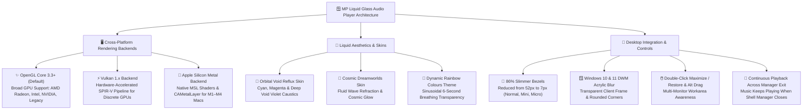

### ✨ Liquid Glass Player Highlights:
- 🪟 **86% Streamlined Bezel Width**: Dramatically slimmed the outer liquid glass bezel from 52px down to **7px** across all renderers. Tightens the window footprint while maximizing usable terminal content:
  - **Default (NORMAL)**: Streamlined 120x40 terminal footprint tightened from 1184x824 down to **1094x734**.
  - **Mini Mode (MINI)**: Compact 74x14 player scaled down to **680x266**.
  - **Micro Mode (MICRO)**: Ultra-compact single-strip 74x7 HUD scaled down to **680x140**.
- 🖥️ **Tri-Engine Rendering Architecture**:
  - **High-Compatibility OpenGL Core 3.3+ (`MP_Audio_Player_Liquid_Glass_OpenGL.py`)**: The primary default backend. Runs smoothly across AMD Radeon, Intel Iris/Arc, NVIDIA GeForce, and legacy OpenGL-capable GPUs without requiring Vulkan drivers.
  - **Native Vulkan 1.x (`MP_Audio_Player_Liquid_Glass.py`)**: High-performance SPIR-V fragment shader pipeline (`shaders/liquid_glass.frag`) rendering refractive caustics, specular highlights, and shaded well geometry.
  - **Apple Silicon Metal (`MP_Audio_Player_Liquid_Glass_macOS.py`)**: Built natively for macOS Sequoia and Sonoma using `CAMetalLayer`, unified memory command buffers, and Metal Shading Language (`shaders/liquid_glass_metal.metal`). Delivers sub-millisecond frame rendering and zero battery drain on Apple Silicon M1/M2/M3/M4 Macs.
- 🪟 **Native Windows 10 & 11 Support**:
  - Leverages Desktop Window Manager (DWM) frame extension (`DwmExtendFrameIntoClientArea` with `-1` margins) and DWM Acrylic blur for a true transparent glass window on Windows 10 and 11.
  - Win32 console docking (`SetParent`, `SetWindowPos`) hosts the terminal player directly inside the glass well without external dependencies.
  - One-click launcher: `launch_liquid_glass.bat`.
- 🖱️ **Double-Click Maximize, Restore & Precision Dragging**:
  - Double-click the top glass bezel to instantly maximize the player to the active display's monitor workarea; double-click again to restore exact previous window dimensions.
  - Full multi-monitor awareness querying monitor workarea bounds.
  - Move the window effortlessly by dragging the top bezel or holding `Alt`/`Super` anywhere within the player.
- 🔄 **In-Process Mini & Micro Modes (`M` Key)**:
  - Press **`M`** inside the player to seamlessly cycle between **NORMAL**, **MINI**, and **MICRO** modes without spawning external terminals. The glass window dimensions and inner character grid rescale in-place instantly.
- 🎨 **Artistic Skins & Dynamic Breathing Themes**:
  - **"Orbital Void Reflux" Skin**: 1280x820 cover art skin featuring Electric Reflux Cyan (`#00f0ff`), Nebula Flux Magenta (`#ff007f`), Deep Void Violet (`#9d4edd`), and obsidian caustics.
  - **"Cosmic Dreamworlds" Skin**: Cover-wrapped liquid glass skin with fluid wave refraction, cosmic bloom, and dynamic dynamic equalizer palette mapping.
  - **"Dynamic Liquid Glass [Rainbow Colours] (New)" Theme**: Dynamic hue shifting that cycles slowly through all rainbow colors in real time, accompanied by a 6-second sinusoidal breathing transparency oscillation (±9% shift) and a firmer, crisper 10% base transparency reduction.
  - **"MP Dreamworlds Liquid Transparency" [Special Edition]**: Theme featuring deep liquid ocean glass (`#4899ef`), crystalline aqua cyan (`#00f5ff`), and liquid amethyst (`#c77dff`).
- 🎵 **Continuous Music Playback Across Manager Exit**: Closing the terminal manager safely skips terminating Liquid Glass processes (`is_liquid_glass_open`), allowing you to keep enjoying your music uninterrupted.
- 🎁 **Desktop Icon & First-Run Reward System**: Includes an ultra-high-resolution 512x512 translucent liquid glass desktop icon (`assets/mp_liquid_glass_icon.png`). On first launch, a desktop shortcut (`~/Desktop/MP_Liquid_Glass_Audio_Player.desktop`) is automatically installed alongside a heartfelt welcome message from MPlanetarian.

---

## 🔮 Spotlight: MP Liquid Visualizer (Native Vulkan 3D Audio-Reactive Raymarching)

> [!TIP]
> **Witness music transformed into pure, hypnotic 3D geometry!** Launchable via **Option 23** in the Manager, pressing **`Z`** inside MP Audio Player or Mix Archive Manager, or running `mix-archive-manager visualizer`, the **MP Liquid Visualizer** (`MP_Liquid_Visualizer.py`) is an autonomous, borderless 1400x1400 3D raymarching visualizer built in native Vulkan 1.x.

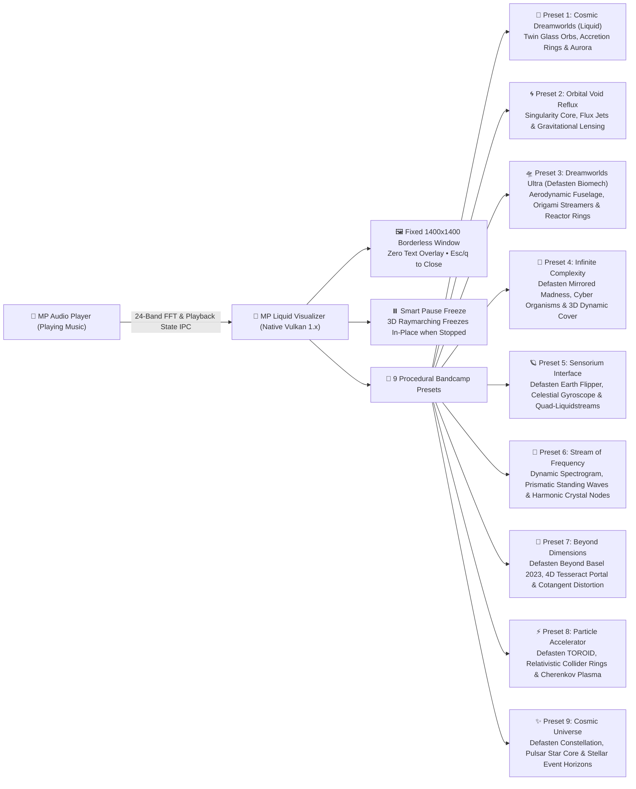

### 🔮 MP Liquid Visualizer Highlights:
- ⚡ **Built from the Ground Up in Vulkan 1.x (Cross-Platform)**: Native Vulkan graphics pipeline (`libvulkan` / `MoltenVK` / `vulkan-1.dll` + `GLFW`) with custom compiled SPIR-V vertex and fragment shaders (`shaders/mp_liquid_visualizer.frag.spv`), UBO telemetry binding, and GPU device-local cover image samplers. Fully supported across Linux, macOS (Apple Silicon via MoltenVK), and Windows 10 & 11.
- 🖼️ **Fixed 1400x1400 Borderless Pure Visual Window**: Designed for pure visual immersion — locked to a non-resizable `1400x1400` borderless square window with **zero text overlay ever displayed**, no scrollbars, and no HUD clutter. Closes instantly on pressing `Esc` or `q`.
- 🎵 **Continuous 3D Audio Reactivity & Instant Pause Freeze**:
  - Continuously ingests real-time 24-band FFT telemetry and playback state from `MP_Audio_Player` via shared memory/IPC (`~/.config/mix-manager/mp_player_state.json`).
  - Animates 3D Signed Distance Field (SDF) geometry, displacement ripples, reactive accretion rings, and kinetic shards in sync with the music.
  - **Instant Freeze-in-Place**: The instant music is paused or stopped, the 3D generation freezes in-place and preserves the exact visual frame, waiting seamlessly for you to resume playback.
- 🎨 **Strict 1-Bandcamp-Cover-per-Preset Architecture**: Every preset is uniquely paired with an official high-resolution MPlanetarian Bandcamp cover art asset:
  - **Preset 1: "Cosmic Dreamworlds (Liquid)"** (`cosmic_dreamworlds_liquid`):
    - Inspired by the front-page Bandcamp release **`MPlanetarian - Cosmic Dreamworlds [Deluxe Edition]`**.
    - Renders twin translucent liquid glass planetary orbs connected by an undulating metaball bridge.
    - Features concentric incandescent crimson/gold/emerald accretion rings, cascading mycelial light conduits, kinetic polyhedral shards, and a diagonal aurora beam across deep space.
  - **Preset 2: "Orbital Void Reflux"** (`orbital_void_reflux`):
    - Paired with `Cover_WMI_V2.png`.
    - Procedural 3D gravitational singularity core surrounded by fluid reflux satellites, dual-tier relativistic accretion rings, helical axial flux jets, and kinetic polyhedral shards.
    - Features **relativistic gravitational lensing** that warps the cover artwork into concentric photon ring arcs around the singularity.
  - **Preset 3: "Dreamworlds Ultra (Defasten Biomech)"** (`dreamworlds_ultra_defasten`):
    - Directly inspired by Defasten's seminal visual work on *XINRI D - YAPORIGAMI* and `Start_Menu_Icon.png`.
    - Features an **aerodynamic biomechanical fuselage & engine spine** rendered with frosted pearlescent glass, translucent caustics, and audio-reactive ripple displacement.
    - **Twin High-Intensity Cyan Reactor Rings & Drive Gimbals** orbiting perpendicularly to the spine axis with bass-pulse glow and white-hot laser centers.
    - **Helical Origami Sakura Streamers & Ribbons** that wrap around the fuselage and dynamically curl in real time.
    - **Floating Chrome Hexagon Armor Plates** (`sdHexPrism`) and origami shards revolving in dynamic 3D orbits.
    - **High-Tech Slate Cyber Studio** with laser light beams and floating nano-dust origami particles.
  - **Preset 4: "Infinite Complexity"** (`infinite_complexity`):
    - Inspired exclusively by **Defasten's *Neo Shibuya 2023: Mirrored Madness*** and **`Cover_v4.png`** (`/run/media/mplanetarian/GAMES1/DATA_DRIVE_MOVED/MPlanetarian Bandcamp Covers/Cover_v4.png`).
    - **Exact Authentic Color Palette**: Faithfully matches the exact colors of `Cover_v4.png`: Deep Obsidian Space Void (`#020103`), Dark Emerald Forest Cyan-Teal (`#1c2e28`), High-Voltage Neon Mint Green (`#2ae277`), Radiant Mint Glow (`#95d6aa`), Celestial Rose Quartz / Lavender Mist (`#f8e8fc`), Ethereal Rose Quartz (`#e4b1c1`), Deep Mystic Magenta (`#813952`), Cosmic Sage Mist (`#7d9184`), and Warm Starlight Gold (`#e7e5c3`).
    - **Entirely 3D & Dynamic Background**: The cover art is mapped into an undulating 3D ray-projected manifold with dynamic depth parallax, chromatic dispersion ray-sampling, a receding Defasten mirrored perspective lattice, and floating quantum starlight dust drifting in 3D space.
    - **3D Effects & Cyber Organism on Top**: Renders an unfurling cybernetic organism with segmented vertebrae capsules, biomorphic rib ripples, incandescent mirrored kinetic rings & portal arcs, 4 sinuous helical tendrils, and deconstructed origami hex plates.
    - **Fast & Strange Movements Synchronized to Music**: Executes sharp non-linear snap turns and micro-glitch saccades on audio peaks, alongside non-Euclidean space foldings and kaleidoscopic deconstructions, staying locked to the music and freezing when stopped.
    - **Gradual Dynamic Time Frame**: Integrates a dynamic harmonic time frame modulation that gradually accelerates the tempo into hyper-complex motion and decelerates smoothly into hypnotic liquid suspension over time.
  - **Preset 5: "Sensorium Interface"** (`sensorium_interface`):
    - Inspired by Defasten's 2022 generative masterpiece with Yaporigami: ***Earth Flipper*** (*"A primordial liquidstream of celestial origin spins itself back into existence 🌀🌌💦"*) and **`Sensorium_Interface.jpeg`** (`/run/media/mplanetarian/GAMES1/DATA_DRIVE_MOVED/MPlanetarian Bandcamp Covers/Sensorium_Interface.jpeg`).
    - **Extremely Complicated & Monumentally Slow Moving**: Designed with slow, hypnotic gyroscopic precession and vast dimensional rotational speed, giving it an immense sense of scale, intricate depth, and non-Euclidean complexity.
    - **Tri-Axis Interlocking Gyroscopic Liquid Core**: Renders 3 concentric, counter-rotating liquid glass toroids with hydraulic harmonic wave distortion and an inner pulsing celestial liquid glass orb.
    - **Braided Quad-Helical Liquidstreams**: 4 interwoven celestial liquidstreams winding along the spine, flexing with low-mid audio frequencies.
    - **6 Articulating Biomech Flipper Wings & Origami Sensorium Shards**: Symmetrical hexagonal cyber-armor plates flanking the core that slowly flap and articulate in sync with music transients.
    - **Relativistic Accretion Halos & Resonance Rings**: Multi-tier planetary rings with fine radial ripples glowing in bioluminescent cyber cyan, sensorium rose quartz, and radiant orchid.
    - **3D Dynamic Celestial Environment**: Ray-projected celestial void with chromatic dispersion, undulating auroral sheets of Earth Flipper jade and iridescent mauve, and twinkling quantum starlight.
  - **Preset 6: "Stream of Frequency"** (`stream_of_frequency`):
    - Inspired by the official album cover of **`MPlanetarian - Stream of Frequency`** (`assets/stream_of_frequency_cover.jpg` / `COVERS/Stream_of_Frequency_Preset.png`).
    - **Dynamic Spectrogram & Rainbow Stream Architecture**: Interweaving standing-wave fluid ripples with harmonic octahedron crystal nodes and continuous spectrum wave displacement.
  - **Preset 7: "Beyond Dimensions"** (`beyond_dimensions`):
    - Inspired by Defasten's generative film ***Beyond Basel 2023*** (`20231129 - BEYOND BASEL 2023： DEFASTEN [IoEpQ09v2l4].mkv`) and **`Cotangent Dimensions (In Progress) [album].png`** from `/run/media/mplanetarian/WD BLACK B/MPlanetarian Bandcamp Covers/`.
    - **Non-Euclidean 4D Hyperdimensional Architecture**: Features a 4D hypersphere liquid glass core modulated by cotangent topological wave harmonics (`sdSphere` with non-linear cotangent distortion), concentric tesseract lattice frame rings, 4-axis braided interdimensional flux streamers, and floating octahedral rift crystals.
    - **Authentic Signature Palette**: Deep Interdimensional Void (`#070814`), Hyperdimensional Ultraviolet (`#6b11ff`), Electric Cotangent Cyan (`#00f5d4`), Non-Euclidean Prism Magenta (`#f72585`), Transdimensional Amber Gold (`#fee440`), and Luminous Quantum Pearl (`#f0f8ff`).
    - **3D Dimensional Rift Environment**: 3D ray-projected multidimensional void with chromatic dispersion, 4D perspective warping, ultraviolet auroral waves, and quantum fluctuation starlight.
  - **Preset 8: "Particle Accelerator"** (`particle_accelerator`):
    - Inspired by Defasten's generative masterpiece ***TOROID (feat. Yaporigami)*** (`20191112 - TOROID (feat. Yaporigami) [_2vtEhBzPsE].mkv`) and **`Vortex Sync (Mateh's Version) [track].png`** from `/run/media/mplanetarian/WD BLACK B/MPlanetarian Bandcamp Covers/`.
    - **Relativistic Synchrotron Collider Architecture**: Dual counter-rotating magnetic containment accelerator toroids revolving in high-speed magnetic precession, central high-energy plasma collision spindle expanding violently on bass transients, quad-sector relativistic helical beam sprays, and heavy electromagnetic quadrupole focusing coil blocks (`sdBox`).
    - **Authentic Signature Palette**: Hadron Vacuum Void (`#04050a`), Synchrotron High-Flux Blue (`#00d2ff`), Relativistic Plasma Violet (`#7928ca`), Collision Neon Pink (`#ff0080`), Cherenkov Radiation Aqua (`#00ffbf`), and Incandescent White-Hot Collision Core (`#ffffff`).
    - **High-Flux Collider Chamber Environment**: Relativistic synchrotron vacuum with high-velocity Cherenkov radiation aura, electromagnetic ionization trails, and magnetic confinement flux lines.
  - **Preset 9: "Cosmic Universe"** (`cosmic_universe`):
    - Inspired by Defasten's seminal celestial work ***Constellation (2012)*** (`20120811 - Constellation (2012) [ISIu20AePHw].mkv`) and **`The Cosmological Horizon (2026 Remaster) [track].png`** from `/run/media/mplanetarian/WD BLACK B/MPlanetarian Bandcamp Covers/`.
    - **Monumental Celestial Constellation Architecture**: Pulsating liquid glass pulsar star nucleus with high-frequency corona ripples, multi-tier cosmological event horizon accretion rings, 6-point celestial constellation web filaments, and floating octahedron diamond star nodes (`sdOctahedron`).
    - **Authentic Signature Palette**: Cosmological Abyssal Black (`#020208`), Deep Space Nebula Blue (`#0a2540`), Celestial Starlight Cyan (`#38bdf8`), Supernova Solar Gold (`#fbbf24`), Cosmic Dawn Rose Nebula (`#fb7185`), and Brilliant Stellar Diamond Core (`#fdf4ff`).
    - **Deep Space Cosmological Environment**: 3D ray-projected cosmological void with stellar constellation star grids, twinkling pulsar beacons, and cosmic dawn nebulae.
- ⌨️ **Runtime Preset Hotkey Switching & Texture Re-Upload**:
  - Press **`[1]`** through **`[9]`** while the visualizer is open to switch presets instantly.
  - The Vulkan texture descriptor dynamically re-uploads the corresponding cover art directly to GPU device-local memory without stuttering or reloading shaders.
  - Full CLI flag support: `--preset <name>`, `--set-preset <name>`, `--list-presets`.
- 🎛️ **Full Suite & Manager Integration**:
  - Launch with hotkey **`Z`** inside MP Mix Archive Manager or MP Audio Player.
  - Manage and select active presets via Option 23 (Visual Media Suite) in `Mix_Archive_Manager.sh`.

---

---

## 🌌 Spotlight: MPlanetarian Dreamworlds & TUI Navigation

> [!IMPORTANT]
> **Experience the default aesthetic, Cosmic Supernova Special Edition, and instant `/` search navigation!** MP Mix Archive Manager defaults to the **MPlanetarian Dreamworlds** theme — inspired by the iconic KDE Plasma Sweet / Nice neon aesthetic (sweet hot pink `#f72585`, electric coral `#ed254e`, vibrant orange `#ff7200`, electric cyan `#00e5ff`, and neon violet `#bd93f9`). It features a modern **zero-fork interactive TUI menu system** with real-time **`/` search filtering**, arrow-key navigation, instant Enter selection, and single-key `Esc` returns across all menus.

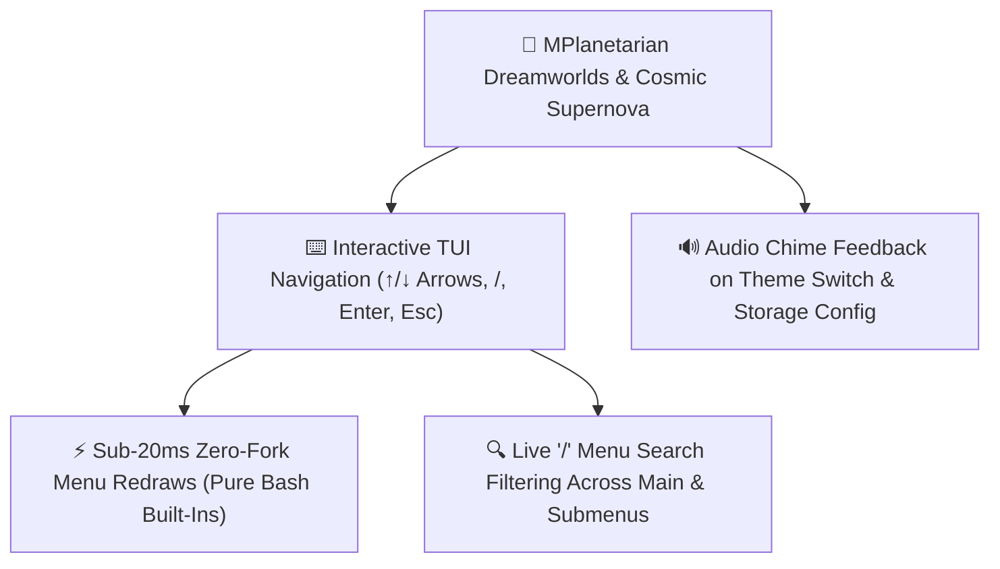

### 🎨 Dreamworlds, Cosmic Supernova & Zero-Fork TUI Features:
- 🌈 **MPlanetarian Dreamworlds & Cosmic Supernova Palettes**: Hand-crafted 24-bit TrueColor RGB schemes matching KDE Plasma Sweet / Nice themes, plus the **Cosmic Supernova [Special Edition]** interstellar palette and **Old Style Unix Terminal Retro Mode (White on Black)**.
- 🔍 **Interactive `/` Menu Option Search Filtering**: Press `/` on the Main Page or any submenu to filter options in real time as you type (matching option number, title, or description via `_find_menu_search_match`), cycle matches with `Up`/`Down` arrows, press `Enter` to execute, or press `Esc` to clear the filter.
- ⚡ **Zero-Fork Bash Architecture & Sub-20ms Redraws**: Engineered for maximum responsiveness even on ultra-slow systems — `Mix_Archive_Manager.sh` and `.probe_mgr.sh` use pure Bash parameter expansion, in-memory caching, and zero external subshell forks during rendering.
- ⌨️ **Interactive Arrow-Key Navigation**: Navigate effortlessly using `Up` and `Down` arrow keys, jump with `Home` and `End`, type numbers or letters to quick-search, press `Enter` to select, and press `Esc` to instantly return to the previous screen.
- 🔊 **System Sound Feedback**: Plays soothing system audio chimes via PipeWire / ALSA when switching themes or configuring mix archive storage locations.
- 🎭 **14+ Built-in Themes**: Dreamworlds (Default), Dreamworlds Ultra (BTOP HotPurpleTrafficLight), Cosmic Supernova [Special Edition], Old Style Unix Terminal Retro (White on Black), Cyberpunk, Dracula, Nord, Matrix, Solarized, Tokyo Night, Monokai, Gruvbox, Emerald, and Classic ANSI (synchronized with `mix_web_companion.py` and `Congen` v1.1's 18-theme selector).

---

## 🎧 Spotlight: MP Audio Player (Terminal Audio Suite)

> [!TIP]
> **Built-in Audio Playback with Mini/Micro Modes, Local Spek Generation, 31K+ SMB Track Streaming & DJ Mode!** Launchable directly via **Option 1** (Advanced MUSIC Mode for SMB music folders `/MUSIC001` & `/MUSIC002`) or **Option 12** (Mix Archive Mode), or `mix-archive-manager p`, **MP Audio Player** (`MP_Audio_Player.py`) is an in-terminal high-resolution music player engineered for seamless playback of 32-bit, 24-bit, and 16-bit FLAC, WAV, MP3, OGG, and AAC tracks.

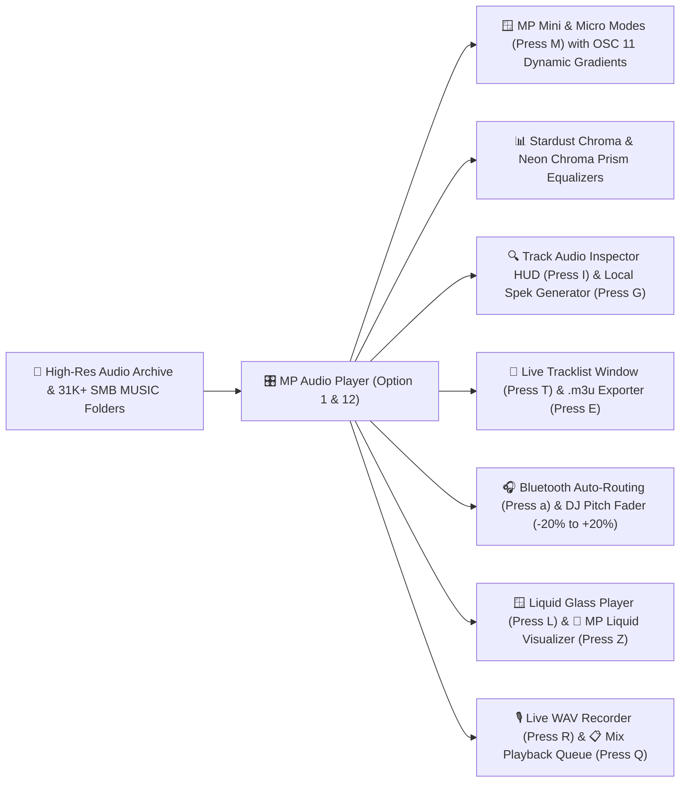

### 🎛️ Audio Player Highlights:
- 🎛️ **10-Band Graphic Equalizer & Electronic Music Presets (`E` Key)**: Interactive real-time DSP equalizer with tailored electronic music curves: **Flat** (default 0.0 dB), **Ambient**, **Trance**, **Techno**, **House**, **Progressive**, and **Vapourwave**.
- 🎚️ **Interactive Slider HUD & Custom User Presets**: In-player modal Equalizer HUD (`E` key) displaying decibel scale (-12.0 to +12.0 dB), band selection (`Left`/`Right`), manual slider adjustment (`Up`/`Down` in ±0.5 dB steps), preset cycling (`P`/`Tab`), quick jump (`1`–`7`), and custom preset naming/saving (`S` key) to disk.
- 🪟 **MP Mini Audio Player Mode (`M` Key) & Hidden MICRO Mode**: Press **`M`** to launch an independent compact transparent console window featuring **dynamic quasi-periodic color gradients** shifting smoothly via irrational phase modulation (`OSC 11`), a real-time mini equalizer, volume/pitch controls, and complete track metadata without the playlist. Press **`M`** again inside Mini Mode to toggle the ultra-compact **MICRO Mode**.
- 📊 **Local 1080p Spek Spectrogram Generator (`G` / `g` Key)**: Press **`G`** at any time during playback, browsing, or inside the Track Inspector HUD to generate a high-resolution 1920x1080 logarithmic Spek spectrogram (`.png`) for the currently selected or playing track/mix, saved directly to `SPEK_OUTPUTS`.
- 🔍 **Track Audio Inspector HUD (`I` / `i` Key)**: Opens a centered modal telemetry overlay inspecting active track format/codec, sample rate, bit depth, channels, file size, live volume & DJ pitch state, hardware audio output engine, and full SMB network or local disk path.
- 🌐 **SMB Network MUSIC Folders Streaming (Option 2)**: Connects to `/MUSIC001` and `/MUSIC002` SMB shares (`192.168.1.138`, **31,271+ tracks**) using `rclone` VFS full caching (`--vfs-cache-mode full`), pre-cached `.m3u8` playlists, and an asynchronous background **Track Duration (`00:00`)** column in the playlist browser.
- ✨ **Stardust Chroma & Neon Chroma Prism Visualizers (`e` Key)**: Includes the **Stardust Chroma** visualizer (thin vertical bars with falling dust particle physics), **Neon Chroma Prism**, Cosmic Supernova gradients, Stereo, Mirror, Fire, Rainbow, and Waves.
- 🌌 **DREAMWORLDS ULTRA AUDIO MODE & 118-Column Panoramic Grid**: High-resolution studio playback console with real-time audio telemetry, bit-depth/sample-rate metrics, stereo level meters, and dedicated DJ pitch fader window aligned flush at column 118.
- 📜 **Instant Tracklist Viewer (`T` / `t` / `--tracklist`)**: Press `T` during playback or browsing to automatically locate and launch the matching mix tracklist (`.txt`) in a dedicated borderless console window (`scripts/view_tracklist_console.sh`).
- 💾 **Universal Playlist Exporter (`w` / `W` / `--export-playlist`)**: Export the entire mix archive playlist to any directory strictly as a standard `.m3u` file (`#EXTM3U` format with `#EXTINF` track descriptions) via native `kdialog`/`zenity` or CLI.
- 🎧 **Intelligent Bluetooth Audio Auto-Routing (`[a]` Key & `monitor_bluetooth_audio.py`)**: Automatically detects connected Bluetooth headphones (Skullcandy Crusher ANC 2, Sony WH-1000XM, AirPods, Bose) in real-time via `pactl subscribe` + 1.2s polling heartbeat. Switches default output (`wpctl`/`pactl`) and migrates active streams live (`pactl move-sink-input`) while respecting manual user sink overrides.
- 🎚️ **DJ Pitch & Tempo Engine**: Real-time tempo adjustment from -20% to +20% via `[` / `]` (or `+` / `-`) with single-key reset via `\`.
- ⌨️ **Unbuffered Zero-Lag Keyboard Controls**:
  - `Space`: Instant pause / play toggle.
  - `E`: Toggle **10-Band Graphic Equalizer HUD & Presets** modal.
  - `M` / `m`: Launch **MP Mini Audio Player Mode** (press `M` again inside Mini Mode for **MICRO Mode**).
  - `G` / `g`: Generate local 1080p **Spek spectrogram** for selected / playing track or mix.
  - `I` / `i`: Open **Track Audio Inspector HUD** modal overlay.
  - `/`: Interactive live playlist search filter.
  - `Left` / `Right` arrows: Precision seek backward / forward (5s / 30s) [In Equalizer HUD: select frequency band 1–10].
  - `Up` / `Down` arrows (or `v` / `V`): Volume control (0%–100%) [In Equalizer HUD: adjust band slider ±0.5 dB].
  - `u` / `U`: Instant audio mute / unmute toggle.
  - `[` / `]` (or `-` / `+`): Adjust DJ pitch (-20% to +20%); `\` resets pitch to 0.00%.
  - `a` / `A`: Route / check Bluetooth audio output status.
  - `T` / `t`: Open tracklist for currently selected or playing mix in dedicated window.
  - `w` / `W`: Export entire mix playlist to `.m3u` file.
  - `n` / `p`: Next / Previous track in mix catalog.
  - `c` / `C`: Cycle TrueColor visualizer theme palette (including MP Dreamworlds Liquid Transparency, Cosmic Supernova & Retro Unix White-on-Black; dynamically matches all panel lines).
  - `t` / `T`: Open Tracklist Viewer for selected mix in a dedicated window (rendered with Liquid Glass container and theme matching when running in Liquid Glass mode).
  - `M` / `m`: In standard player, launches Mini Mode window; in Liquid Glass player, cycles in-place between Normal, Mini, and Micro modes.
  - `e`: Toggle EQ visualizer style (Stardust Chroma, Neon Chroma Prism, Stereo, Mirror, Fire, Rainbow, Waves, Classic).
  - `F`: Open currently selected / playing mix in desktop file manager (Dolphin / Nautilus / Explorer / Finder).
  - `Q` / `q`: Enqueue currently selected track/mix to play next (priority queue with cyan badge).
  - `s` / `S`: Toggle playlist shuffle mode on/off.
  - `y` / `Y`: Repeat / Loop mode cycle (`ALL` / `ONE` / `OFF`).
  - `L` / `l`: Launch **MP Liquid Glass Player** standalone window (OpenGL / Vulkan / Metal).
  - `Z` / `z`: Launch **MP Liquid Visualizer** (1400x1400 borderless Vulkan 3D audio-reactive raymarching window).
  - `R` / `r`: Toggle lossless 16-bit PCM WAV audio recording (with 3GB auto-rollover and `● REC` indicator).
  - `q` / `Esc`: Return cleanly to master manager menu [In Equalizer HUD: close HUD].
- 🔍 **Integrated Archive Catalog Browser & Flexible Path Ingestion**: Pass specific mix audio paths directly via CLI or browse the entire catalog by mix episode, artist, title, or date with instant enter-to-play dispatch.
- 🎧 **Audio Bit-Perfect Output**: Direct integration with PipeWire, ALSA, PulseAudio, macOS CoreAudio, and WASAPI.

---

## 📱 Spotlight: DJ Booth & Studio Mobile Web Companion

> [!IMPORTANT]
> **Control your workstation from your phone or tablet in the DJ booth!** MP Mix Archive Manager includes **mix_web_companion.py** (Option 28.5 or `mix_web_companion.sh`), a zero-dependency local HTTP server running on port **`8888`** designed specifically for smartphones, tablets, and touchscreens.

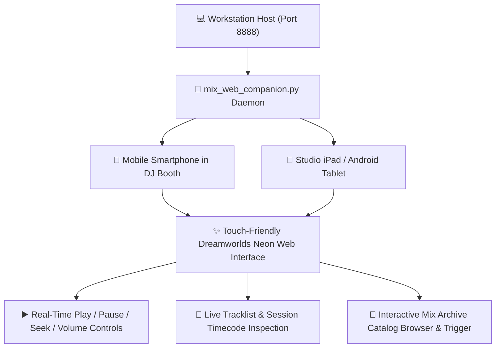

### 📱 Mobile Web Companion Highlights:
- 🌐 **Zero Dependencies**: Powered by Python's built-in standard library HTTP server (`mix_web_companion.py`) — requires no external Node.js, Flask, or heavy web frameworks.
- 🎨 **Responsive Dreamworlds UI**: Tailored dark neon palette optimized for OLED mobile displays in low-light DJ booths and studio environments.
- 🎛️ **Full Remote Control**: Play, pause, skip, seek, mute, adjust master volume, inspect now-playing audio bit depth/sample rate, and browse the mix archive catalog over local Wi-Fi.
- 🔒 **Local Network Isolation**: Binds securely to your local LAN IP (`http://<WORKSTATION-IP>:8888`) with optional trusted-host verification.

---

## 🎬 Spotlight: YouTube Shorts 1080x1920 Promotional Video Generator

> [!TIP]
> **Need vertical social media promo videos for YouTube Shorts, Instagram Reels, or TikTok?** Option 20.7 (`generate_youtube_short_promo.py`) automatically synthesizes dynamic **1080x1920 vertical videos** (42 seconds default) straight from your master FLAC mix and cover art!

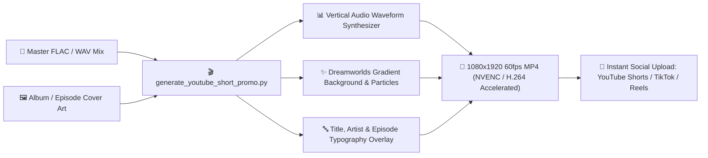

### 🎥 Shorts Generator Highlights:
- 📐 **True 1080x1920 Vertical Canvas**: Perfectly formatted for YouTube Shorts, Instagram Reels, and TikTok without letterboxing.
- 🌊 **Dynamic Audio Visualizer**: Renders an animated audio waveform reflecting the highest-energy section of your mix.
- 🚀 **Hardware Acceleration**: Automatic GPU encoding using NVIDIA NVENC (`h264_nvenc`), Apple VideoToolbox (`h264_videotoolbox`), or CPU `libx264`.
- 🎚️ **Smooth Audio Fades**: Includes studio-grade 320kbps AAC audio with smooth 1.5s intro and outro fades.

---

## 🎥 Spotlight: Screencast YouTube Video Generator with NVENC & Image Transitions

> [!TIP]
> **Need full-length 1080p/4K YouTube videos with seamless image transitions for live streams and studio sessions?** Located in `scripts/generate_screencast_youtube_video.py`, this tool automates full episode screencast rendering with hardware-accelerated NVIDIA NVENC encoding, cyclic artwork transitions, and broadcast-grade audio mastering.

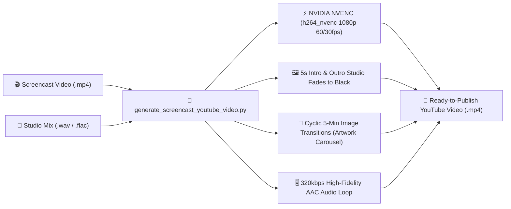

### 🎬 Screencast Video Generator Highlights:
- ⚡ **Hardware-Accelerated NVIDIA NVENC**: Leverages dedicated NVENC silicon (`h264_nvenc`) for blazing-fast 1080p / 4K video rendering without pegging CPU cores.
- 🖼️ **Seamless 5-Minute Image Transitions**: Automatically cycles through high-resolution episode artwork and interface graphics every 5 minutes with smooth 1-second crossfades.
- 🌑 **Studio Intro & Outro Fades**: Elegant 5-second fade-in from black at video start and 5-second fade-out to black at video conclusion.
- 🎶 **Broadcast-Grade Looped Audio**: Synchronizes pristine 320kbps AAC studio audio, looping seamlessly to match video length with smooth 5-second audio intro/outro envelopes.
- ⏱️ **Uniform Timescale Architecture**: Single-stream segment concatenation enforcing a standardized 90,000 timescale to eliminate audio/video desync and YouTube processing errors.

---

## 🤖 Spotlight: Next-Gen AI Orchestration, Matrix Voice Lab & Infinite Talker Suite

> [!IMPORTANT]
> **Orchestrate Local LLMs, Matrix & Stephen Hawking Neural Voice Cloning, Infinite Talker AI Video Synthesis, and System Diagnostics from One Central Hub!** Main menu **Option 33** unites local and remote artificial intelligence pipelines:

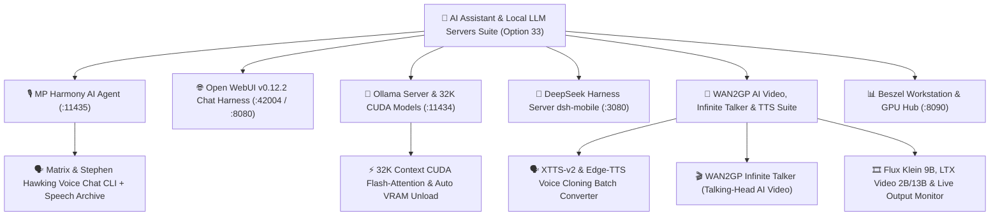

### 🧠 AI Suite Capabilities:
- 🎙️ **MP Harmony AI Agent & Speech Archive** (`manage_harmony_agent.sh` / Option 33.4): Autonomous engineering agent and voice bridge running on port 11435. Includes background daemon with setsid detachment, zero-lag port readiness wait, automatic speech recording to the **MP Harmony Agent Audio Speech Archive**, and interactive **Voice Chat CLIs** (`local-voice-talk` for Harmony Agent or local Ollama models).
- 🕶️ **Matrix Cast & Stephen Hawking Voice Cloning Lab**: Full neural XTTS-v2 and Edge-TTS voice synthesis featuring **Agent Smith / Elrond (Hugo Weaving)**, **5 Morpheus variants** (Construct, Red Pill, Dojo, System, Classic), **Neo**, **Trinity**, **The Oracle**, **Zion**, and **Stephen Hawking (Enters the Matrix)** with authentic acoustic pacing.
- 🎬 **WAN2GP Infinite Talker AI Video & Output Monitors** (`wan2gp.sh`, `wan2gp_tts_batch.py`, `wan2gp_flux_batch.py`, `wan2gp_ltx_batch.py`):
  - **Infinite Talker Integration**: Generates talking-head AI videos (including Stephen Hawking talking-head video briefings) with configurable video length and automatic Python `.venv` discovery.
  - **Live Output Monitors**: Dedicated real-time **WAN2GP Video Output Monitor (`--wan2gp-monitor`)** and **Audio/Video File Output Monitor (`--audio-monitor`)**, plus one-click WAN2GP upstream Git updating.
  - **Text-to-Speech (TTS) Batch Suite**: Converts `.txt` scripts into uncompressed `.wav` speech audio with Matrix/Hawking/British neural voices and interactive playback.
  - **Video Batch Generators**: Flux Klein 9B and LTX Video 2B/13B generation profiles (Profiles 2 and 4.5).
- 🌐 **Open WebUI v0.12.2 Web Chat** (`scripts/manage_open_webui.sh` / Option 33.3): Browser-based chat interface connected to local models on port 42004 / 8080 with automatic version update support.
- 🦙 **Ollama Server & 32K CUDA Models** (`manage_ollama.sh` / Option 33.2): Distrobox / host controller on port 11434 tuned for **32K context windows (`num_ctx 32768`)**, CUDA flash-attention, automatic GPU VRAM unloading, model puller (`qwen2.5`, `llama3.1`, `nemotron`), and CLI voice/text chat.
- 📱 **DeepSeek Harness (`dsh-mobile`) & Token Manager** (`scripts/dsh_mobile.sh` / Option 33.5): Web chat harness on port 3080 optimized for mobile devices with interactive access token management.
- 📊 **Beszel Server Monitoring Hub & Agent** (`beszel.sh` / Option 33.7): Real-time hardware, CPU, NVIDIA GPU, and container telemetry web dashboard on port 8090.

---

## 📊 Spotlight: MP Reporter Suite, AI Brain Logs & Automated Email Briefings

> [!IMPORTANT]
> **Automated Daily, Weekly, Monthly, and Yearly Workstation & Mix Intelligence Reports!** Launchable via **Option 27** (`mp_report_generator.py`, `mp_scheduled_reporter.sh`, `manage_mp_reporter.sh`), the **MP Reporter Suite** aggregates mix archive statistics, task completions, AI agent activity, and system telemetry into styled HTML5 dashboards, printable PDFs, Stephen Hawking audio/video briefings, and scheduled SMTP emails.

### 📈 MP Reporter Highlights:
- 🗓️ **Multi-Period Intelligence Architecture**: Generates **Daily, Weekly, Monthly, and Yearly** reports organized cleanly into `REPORTS/{DAILY,WEEKLY,MONTHLY,YEARLY}` with backward-compatible symlinks and an interactive **12-Month Calendar Dashboard**.
- 🧠 **Daily AI Brain Logs Reporter**: Automatically scans and summarizes activity across **Google Gemini**, **Grok**, and **local LLM models** alongside system and mix archive tasks.
- 🗣️ **Stephen Hawking TTS Audio & Infinite Talker Video Briefings**: Synthesizes spoken audio report briefings in Stephen Hawking's signature voice and optionally renders talking-head AI video briefings via **WAN2GP Infinite Talker**.
- 📧 **Automated SMTP Email Distribution (`mp_email_manager.sh`)**: Sends formatted daily/periodic HTML & PDF intelligence briefings directly to configured email recipients on a systemd/cron schedule.

---

## 📱 Spotlight: Congen v1.1 by Dreamworlds Productions (MPlanetarian)

> [!IMPORTANT]
> **Control your entire Linux workstation, custom scripts, and media workflows straight from your smartphone!** Located in [Congen/](Congen/README.md) and launchable directly via `mix-archive-manager --congen` or Option 29, **Congen v1.1 by Dreamworlds Productions (MPlanetarian)** is an enterprise-grade terminal command orchestration suite and interactive CLI manager for KDE Connect (Plasma 6 & 5).

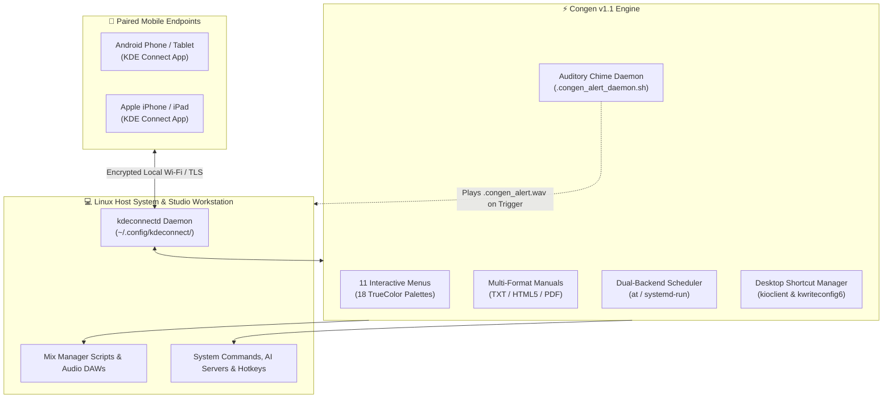

### 📱 Congen v1.1 Feature Highlights:
- 🎛️ **11 Interactive Menus**: Create commands (`[1]`), view & remove (`[2]`), direct terminal execution (`[3]`), task scheduling (`[4]`), audit logging (`[5]`), import/export management (`[6]`), multi-format documentation (`[7]`), auditory alerts (`[8]`), keyboard shortcut generator (`[9]`), desktop shortcut manager (`[10]`), and theme switcher (`[11]`).
- 🎨 **18 TrueColor Themes**: Choose between MPlanetarian Dreamworlds (default), Dreamworlds Ultra, Cosmic Supernova [Special Edition], Old Style Unix Terminal Retro (White on Black), Cyberpunk, Dracula, Nord, Matrix, Solarized, Tokyo Night, Monokai, Gruvbox, Emerald, Classic ANSI, and more.
- 🔔 **Algorithmic Chime Alert Daemon**: Background daemon (`.congen_alert_daemon.sh`) monitors remote executions and plays an algorithmic two-tone chime (`.congen_alert.wav`, 1047 Hz → 1319 Hz) generated purely via Python standard library with zero binary media dependencies.
- 🖥️ **Desktop Shortcut Manager (`[10]`)**: Discovers `.desktop` launchers, executes immediately via `kioclient exec`, binds global hotkeys via `kwriteconfig6` into `kglobalshortcutsrc`, and schedules future launches via `at` or `systemd-run`.
- ⌨️ **Keyboard Shortcut Generator (`[9]`)**: Translates KDE global shortcuts into standalone executable scripts using `xdotool` (X11) or `ydotool` (Wayland), registering them as remote mobile triggers.
- 📑 **Multi-Format Manual Generator (`[7]`)**: Generates structured Plain Text (`.txt`), responsive modern dark-mode HTML5 (`.html`), and print-ready PDF (`.pdf`) via an automated converter cascade (`wkhtmltopdf` → `chromium` → `google-chrome` → `weasyprint`).
- 🤖 **Headless CLI & Scripting Suite**: Full non-interactive automation suite (`congen list [--json]`, `congen run`, `congen add`, `congen remove`, `congen status`, `congen ping`, `congen theme`, `congen alert`) for scripts, hotkeys, and pipelines.
- ⚡ **High-Performance Engine & Atomic Safety**: Global telemetry TTL caching (<20ms menu redraws), elimination of N+1 subprocess bottlenecks via batch extraction, live search filtering (`[s]` / `[/]`), and atomic config writes with `.bak` safety backups.
- 📦 **30+ Bundled Command Profiles (`CONGEN_IMPORT/`)**: Pre-configured profiles for Ollama, WAN2GP AI Video, Beszel, DeepSeek, Steam, Strawberry Player, Audacity, VLC, Audio Mute/Unmute, and LAN-only Internet Kill-Switch with multi-device deduplication.

👉 **Explore the dedicated documentation:** [Congen/README.md](Congen/README.md)

---

## ✂️ Spotlight: Auto-Split DJ Mixes & Multi-Part Spek Spectrograms

> [!TIP]
> **Recorded a 4-hour live stream with 4 different DJ sets?** When converting large audio files, MP Mix Archive Manager automatically prompts you: *"Would you like to split the audio file?"*. It slices the audio into equal or custom parts, saves the split files into the **exact same directory**, and offers to generate **individual 1080p Spek spectrograms** for every split part!

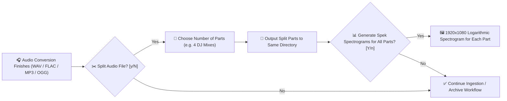

### 🎛️ Audio Splitting & Spectrogram Highlights:
- 🔁 **Every-Time Conversion Prompt**: Never miss splitting a multi-DJ recording session. Immediately upon conversion completion, the system asks if you want to split the file.
- 📁 **Same Output Directory**: All split parts are saved right alongside the converted audio file.
- 📊 **Batch Spek Spectrogram Generation**: One-click generation of ultra-clean 1920x1080 logarithmic audio spectrograms for every individual split set, proving lossless frequency cutoffs and audio mastering health.
- 🦭 **Full Ogg Vorbis Support**: Seamlessly ingest and convert to/from Ogg Vorbis (`.ogg`) at audio quality (Q8 / Q10 / 320 kbps) across all single and batch conversion routines.
- 🧩 **Multi-Archive Origin-Aware Routing**: Batch conversion detects which archive disk source WAV files came from and automatically deposits converted FLACs and spectrograms back to their respective origin drives.

---

## ⏰ Spotlight: MPlanetarians Alarm Clock (Wake Up Edition)

> [!IMPORTANT]
> **Tired of boring buzzer alarms?** MP Mix Archive Manager includes **MPlanetarians Alarm Clock (Wake Up Edition)** — an invigorating morning wake-up system that blasts a random mix from your local FLAC archive through Strawberry or cliamp, unmuting and ramping volume up over 3 minutes. It tracks your mouse to detect when you're truly awake, opens your default web browser on your secondary right-hand monitor, and queries your Steam library to offer **3 random video games to play for breakfast**! *(Linux Only Support at the Moment)*.

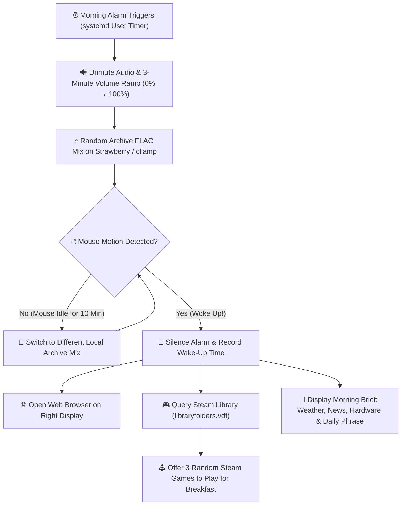

### 🌟 Why This Morning Wake-Up Experience Is Game-Changing:
- 🎵 **High-Energy Lossless Wake-Up**: Randomly selects between **Strawberry** and **cliamp**, pulls a random high-resolution mix from your local archive disks (safely skipping cloud mounts), starts softly, and steadily ramps up the volume over 3 minutes until full alarm volume.
- 🖱️ **Active Movement Wake Detection**: Move the mouse to silence the alarm. If your mouse stays still for 10 minutes, the clock knows you fell back asleep and starts playing a completely different archive mix!
- 🎮 **Steam Video Game for Breakfast**: Automatically parses your Steam library (`libraryfolders.vdf`), filters out developer tools and runtimes, and presents 3 random games from your collection, asking: *"Would you like to play a game for breakfast?"* Launch any chosen title directly into Steam with a single keypress!
- 🖥️ **Smart Dual-Screen Browser Placement**: Automatically calculates your monitor coordinates and opens your morning browser window on the display directly to the right of your primary screen.
- ☀️ **Morning Screen & Daily Brief**: Features an animated clock, daily weather forecast, rain alerts, exercise routine, healthy breakfast ideas, system hardware vitals, manual page of the day, and internet word/phrase of the day.
- 🎨 **4 Elegant Color Themes**: Midnight Ink (navy and silver), Warm Brass (amber lamp-light), Forest Hour (deep green and gold), and Porcelain (warm grey and rose).
- 📊 **Main Page Live Status Banner**: The MP Mix Archive Manager main dashboard directly displays your alarm arm state, next alarm countdown, active sound target, Steam library readiness, and morning wake-up action at a glance.
- 🐧 **Linux-Native System Integration**: Powered by systemd user timers, PipeWire `wpctl`, `xdotool`, and Steam Linux desktop protocols.

---

## ⚡ Spotlight: Traktor History Harmonic Playlist & Stage Setup

> [!IMPORTANT]
> **DJing on macOS with Native Instruments Traktor Pro?** You can convert past live gig recordings and rehearsal history logs into clean, harmonically organized playlists and launch straight into your next mix with a single keypress.


### 🎧 Why Every Traktor DJ on Mac/Windows Needs This:
- 🔍 **Auto-Detection Across Traktor Versions**: Automatically detects your installed Traktor Pro release (Traktor 3, Traktor Pro 3.11+, Traktor Pro 4) and discovers session History `.nml` archives without manual path configuration.
- 📜 **Interactive Session History Browser**: Lists all past performance sessions with session dates, start timestamps, and total tracks played.
- 👁️ **Console Tracklist Preview**: Inspect the full played setlist (Artist, Title, Duration, Key, BPM) in your terminal *before* committing to generate.
- 🎹 **Harmonic Key Ascending Order**: Tracks are automatically sorted in ascending musical / Camelot key order (1A–12B), ensuring harmonic mixing compatibility right from the first transition!
- 📁 **Native Traktor Playlist Injection**: Generates a standard Traktor playlist `.nml` directly inside Traktor's default Root Playlists directory (`$ROOT`), appearing immediately in Traktor's browser tree.
- 🚀 **Instant Full-Screen Stage Dispatch**: Automatically brings Traktor Pro to the front in **Full Screen** mode and pre-loads Decks A, B, C, and D with the first four tracks.

---

## 🎛️ Spotlight: EBU R128 Loudness Mastering, Audio Audit & CUE Engine

> [!TIP]
> **Deliver studio-grade loudness compliance and verify audio integrity before publishing!** Located in **Option 2** and **Option 8**, the audio mastering suite gives you precision control over dynamics, spectral purity, and archive longevity:

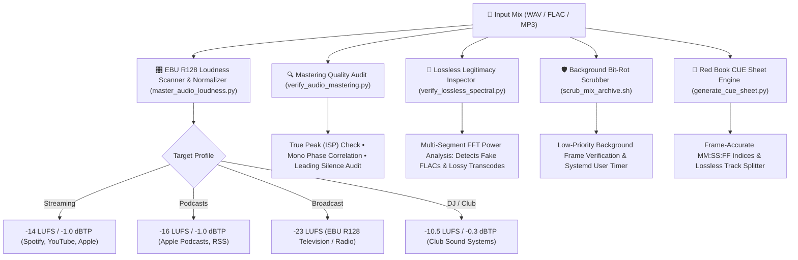

---

## 🔍 Spotlight: Audio Fingerprinting, Chapters & Rekordbox Export

> [!IMPORTANT]
> **Bridge your audio archives with modern streaming platforms and DJ hardware!**

- 🔍 **Acoustic Fingerprinting & Track Identification** (`identify_mix_tracks.py` / Option 13.7): Automatically identifies unknown tracks in live DJ recordings by extracting audio fingerprint snippets and querying AcoustID / Chromaprint (`fpcalc`) and online recognition endpoints.
- 📑 **YouTube & SoundCloud Chapter Exporter** (`export_chapters.py` / Option 13.6): Parses tracklists or CUE sheets to generate clean YouTube description chapters (`00:00:00 Artist - Title`), SoundCloud timestamps, and Markdown tables, automatically copying them to your clipboard (`wl-copy`, `xclip`, `pbcopy`).
- 💿 **Pioneer Rekordbox XML Exporter** (`export_rekordbox_playlist.py` / Option 16.5): Converts Traktor `.nml` histories, CUE sheets, and M3U playlists into standard Pioneer Rekordbox XML (`DJ_PLAYLISTS.xml`), ready for direct import and export to Pioneer CDJ USB drives.
- 🏷️ **Lossless ReplayGain & Metadata Tagger** (`tag_audio_metadata.py` / Option 4.12): Analyzes EBU R128 loudness to write non-destructive Vorbis comments (`REPLAYGAIN_TRACK_GAIN`, `REPLAYGAIN_TRACK_PEAK`) and embeds front cover art into FLAC headers (`metaflac`) without touching audio bits.

---

## 🖥️ Spotlight: KDE Plasma Desktop Shortcuts & Global Keyboard Binder

> [!TIP]
> **Control your workstation tools and AI servers without touching the mouse!** Main menu **Option 0** provides dedicated Linux KDE Plasma desktop automation:

- 🖥️ **Manual Shortcut Runner**: Automatically indexes `.desktop` shortcuts across `~/Desktop`, `~/Desktop/DESKTOP`, and `~/.local/share/applications`, presenting an interactive categorized launcher for games, tools, and servers via `kioclient`.
- ⌨️ **Global Keyboard Shortcut Generator**: Select any installed desktop application or custom script and bind it to a global hotkey (e.g. `Ctrl+Alt+Return`, `Meta+Shift+A`). Automatically registers the binding directly in KDE's `kglobalshortcutsrc` and reloads `kglobalaccel` over D-Bus!

---

## 📢 Spotlight: Unified Multi-Channel Notification Dispatcher

> [!IMPORTANT]
> **Get notified on your phone when 4-hour batch conversions or cloud backups finish!** The unified notification dispatcher (`scripts/send_notification.sh`) broadcasts status updates across four channels simultaneously:

- 🖥️ **Desktop GUI Notifications**: Dispatches native notifications via `notify-send` (Linux), `osascript` (macOS), or PowerShell toast notifications (Windows).
- 💬 **Discord Webhooks**: Posts rich markdown embed notifications to your private Discord server.
- 📱 **Telegram Bot Alerts**: Sends real-time messages to your Telegram chat or channel via the Telegram Bot API.
- 🔔 **Pushover Push Notifications**: Delivers instant push notifications to your iOS and Android devices.

---

## 🚀 Quick Start by Operating System

### 1. Linux (Bazzite / SteamOS / Fedora / Ubuntu / Arch)
For a fresh, step-by-step installation guide from a clean Bazzite Linux setup, see **[INSTALL_BAZZITE.md](INSTALL_BAZZITE.md)**.

```bash
cd ~/MP_Mix_Manager_v0.4
chmod +x install.sh
./install.sh
```

**Launch the Master Console & Players:**
```bash
manager
# or:
./manager.sh
# or launch the new v0.4 features directly:
python3 MP_Audio_Player_Liquid_Glass_OpenGL.py       # Liquid Glass Player (OpenGL Core 3.3+ default)
python3 MP_Audio_Player_Liquid_Glass.py              # Liquid Glass Player (Vulkan mode)
python3 MP_Liquid_Visualizer.py                      # 1400x1400 3D Vulkan Visualizer
```

---

### 2. Apple macOS (Sequoia, Sonoma, Apple Silicon M1–M4 & Intel)

#### Prerequisites
Install [Homebrew](https://brew.sh) (if not already installed):
```bash
/bin/bash -c "$(curl -fsSL https://raw.githubusercontent.com/Homebrew/install/HEAD/install.sh)"
```

Install command-line tools:
```bash
brew install bash ffmpeg sox flac rclone jq btop python
```

*(Optional) Install audio/video GUI tools:*
```bash
brew install --cask vlc audacity strawberry musicbrainz-picard gimp reaper foobar2000
```

#### Running on macOS
1. Run the installer:
   ```bash
   cd ~/MP_Mix_Manager_v0.4
   chmod +x install.sh
   ./install.sh
   ```
2. **Double-click** `manager_macos.command` in Finder, or run:
   ```bash
   ./manager_macos.command
   ```
3. **Launch Apple Silicon Metal Liquid Glass Player:**
   ```bash
   python3 MP_Audio_Player_Liquid_Glass_macOS.py
   ```
4. **One-Click Traktor Prep:** Press **`15`** ➔ **`3`** to convert any past session into an ascending musical key playlist, inject it into Traktor, and auto-load all 4 decks ready to mix!

---

### 3. Microsoft Windows 10 & 11

#### Prerequisites
MP Mix Archive Manager runs natively on Windows using **Git Bash** or **WSL2**:
- **Git for Windows (Recommended)**: Download from [https://git-scm.com/download/win](https://git-scm.com/download/win).
- **Windows Terminal**: Built-in on Windows 11; available via Microsoft Store on Windows 10.

Install recommended utilities using `winget` in PowerShell:
```powershell
winget install Gyan.FFmpeg Rclone.Rclone jqlang.jq
winget install VideoLAN.VLC Audacity.Audacity MusicBrainz.Picard GIMP.GIMP Cockos.REAPER foobar2000.foobar2000
```

#### Running on Windows
- **Double-click `MP_Mix_Manager.exe` or `manager.exe`** (Native 64-bit Windows console executable).
- **Double-click `launch_liquid_glass.bat`** to immediately experience the MP Liquid Glass Audio Player with Windows DWM acrylic blur!
- **Double-click** `manager.bat` or `manager.ps1` from File Explorer.
- Or run inside Git Bash:
  ```bash
  ./Mix_Archive_Manager.sh
  ```

---

### 4. FreeBSD (14.x / 15-CURRENT)

#### Prerequisites
Install dependencies using `pkg`:
```bash
pkg install -y bash python3 ffmpeg sox flac rclone jq btop git py311-mutagen py311-reportlab py311-pillow
```

#### Running on FreeBSD
```bash
cd ~/MP_Mix_Manager_v0.4
chmod +x manager_freebsd.sh install.sh
./manager_freebsd.sh
```

---

## 🎛️ Master Feature Matrix (3 Sections, Options 0–37)

### ─── [ SECTION 1: MIX ARCHIVE WORKFLOW & INGESTION ] ──────────
| # | Operation | Description & Sub-Features |
|---|---|---|
| **0** | **Run Any Desktop Shortcuts — Linux** | Interactive launcher and global keyboard shortcut binder for all KDE Plasma desktop applications, games, audio tools, and AI servers (`_run_desktop_shortcut_manual` & `_bind_desktop_shortcut_keyboard`). |
| **1** | **Play DJ Mixes (MP Audio Player - Mix Archive Mode)** | Built-in terminal audio player (`MP_Audio_Player.py`): "DREAMWORLDS ULTRA AUDIO MODE" expanded 118-column layout, **MP Mini & Micro Modes (`M` key)** with dynamic OSC 11 color gradients, **In-Player Spek Generator (`G` key)**, **Track Audio Inspector HUD (`I` key)**, **Stardust Chroma & Neon Chroma Prism** equalizers, Bluetooth auto-routing (`a` key), dedicated tracklist viewer (`T` / `-t`), universal playlist exporter (`E` / `-e` strictly saving as `.m3u` files), DJ pitch fader (-20% to +20%), and bit-perfect lossless 32-bit/24-bit/16-bit FLAC/WAV/MP3/OGG playback. |
| **2** | **Play Tracks from MUSIC Folders using MP Audio Player (Advanced Mode)** | High-performance music tracks playback engine connecting to remote SMB network shares (`/MUSIC001` and `/MUSIC002` at 192.168.1.138, 31,271+ tracks). Features `rclone` VFS full caching (`--vfs-cache-mode full`), pre-cached playlists (`DJ_Tracks_ALL_MUSIC_FOLDERS.m3u8`), asynchronous **Track Duration (`00:00`)** column, **MP Mini & Micro Modes (`M`)**, **In-Player Spek Generator (`G`)**, and the modal **Track Audio Inspector HUD (`I`)**. |
| **3** | **MP Audio Player (Liquid Glass Mode)** | Dedicated translucent still-water glass window hosting the unmodified MP Audio Player with an **86% slimmer bezel border (7px)** across Default (1094x734), Mini (680x266), and Micro (680x140) modes. Defaults to high-compatibility OpenGL (`MP_Audio_Player_Liquid_Glass_OpenGL.py`) supporting wide GPU hardware (AMD Radeon, Intel, NVIDIA, and legacy OpenGL cards), with configurable NVIDIA/AMD Vulkan mode (`MP_Audio_Player_Liquid_Glass.py`) and Apple Silicon Metal mode (`MP_Audio_Player_Liquid_Glass_macOS.py`). Features Windows 10 & 11 DWM acrylic blur, double-click top bezel maximize/restore, multi-monitor workarea awareness, in-process Mini/Micro modes (`M` key), "Orbital Void Reflux" and "Cosmic Dreamworlds" skins, "Dynamic Liquid Glass [Rainbow Colours]" breathing transparency, and continuous playback across Manager exit. Configurable via Manager Option 15/36 or shortcut `liquid-config`. |
| **4** | **Run Mix Conversion** | High-performance zero-fork batch conversion (`Make_SOF_FLAC_CONVERSION.sh`): multi-archive scanning across configured storage drives, origin-aware output destination routing, sample-accurate split WAV concatenation, 32-bit FLAC encoding, cover art embedding, and Spek spectrogram generation with post-conversion splitting prompt. |
| **5** | **Audio Conversion, EBU R128 Mastering & CUE Sheets** | Comprehensive audio conversion and mastering suite (`convert_audio_format.sh`): converts between FLAC, MP3, Ogg Vorbis, Opus, AAC, ALAC, and WAV bit depths (16/24/32-bit float/int); 2-pass EBU R128 loudness normalizer (`master_audio_loudness.py`); Red Book CUE sheet engine (`generate_cue_sheet.py`); mastering quality audit (`verify_audio_mastering.py`); and Vorbis tag / ReplayGain tagger (`tag_audio_metadata.py`). |
| **6** | **Retrieve Unconverted WAVs from Archive** | Scans archive storage and quarantines/moves unconverted WAV files lacking a matching FLAC master back to the staging area (`MOVE_NOT_CONVERTED_WAVS.sh`). |
| **7** | **Search & Import Mixes from Local Drives & SMB** | Auto-discovers local storage volumes, USB drives, and SMB network shares (`search_and_import_mixes.sh` / `import_new_mixes.sh`). Filters by mix size (>=100MB), deduplicates against archive, and copies with live progress and audit logging. |
| **8** | **Rename a Mix and Associated Assets** | Atomically renames master FLAC files, `.txt` tracklists, and `.png` Spek spectrograms across all archive directories simultaneously. |
| **9** | **Find & Remove Duplicate Audio Files / Mixes** | Deterministic two-tier O(1) partial-hash pre-filter + full SHA-256 and episode duplicate detector (`find_duplicate_mixes.py`); supports audit reports, quarantine to `DUPLICATES_QUARANTINE/`, or safe deletion. |
| **10** | **Export / Copy Mixes to Specified Path** | Bundles and copies complete mix packages (FLAC + Covers + Tracklists TXT/HTML/PDF + Spek) or filtered assets to removable USB flash drives or external directories. |
| **11**| **Audio Integrity, Bit-Rot Scrub & FLAC Verification** | Multi-level integrity suite (`manage_integrity_and_verification`): SHA-256 manifests (`manage_checksums.sh`), multi-threaded FLAC bitstream scanner (`Verify_FLAC_Files.sh`), FFT spectral cutoff inspector to detect fake FLACs (`verify_lossless_spectral.py`), and non-destructive background bit-rot scrub daemon with systemd user timer (`scrub_mix_archive.sh`). |
| **12**| **Cloud & Remote Backup Suite** | Automated multi-cloud backup engine (`backup_mix_archive.sh`): rclone integration for Google Drive, iCloud Drive, Dropbox, and custom destinations with companion asset bundling and sync state badging. |
| **13**| **Storage Management & Multiple Mix Archives Setup** | Displays drive capacity, mount point, free space progress bars, and file counts for all configured mix archive drives; full rescan and refresh; and secondary archive folder configuration (`EXTRA_MIX_ARCHIVE_DIRS`). |

---

### ─── [ SECTION 2: STUDIO AUDIO, PLAYBACK, METADATA & VIDEO ] ──
| # | Operation | Description & Sub-Features |
|---|---|---|
| **14**| **Tracklist Management, Scanning & Metadata Suite** | Complete metadata suite (`manage_tracklist_suite`): browse/search archive tracklists, view in borderless console, export to styled HTML and vector PDF (`generate_tracklist_docs.py`), Traktor XML history extractor (`Check_Find_Tracklists.sh`), master HTML index generator with browser auto-open (`Generate_Master_Tracklist.sh`), MusicBrainz Picard tagger, YouTube/SoundCloud chapter exporter (`export_chapters.py`), and AcoustID audio fingerprint identifier (`identify_mix_tracks.py`). |
| **15**| **Audio Players & Retro Playback Suite** | Universal player launcher (`manage_audio_players`): cliamp retro terminal player, Audacious, VLC, Haruna, Kodi, Strawberry, foobar2000 (macOS & Windows), Winamp (Windows), Apple Music (macOS), Apple Podcasts, Audacity, and MIDI hardware device inspector. |
| **16**| **Configure Mix Archive Storage Locations** | Interactive setup wizard for primary mix storage folder (`MIX_ARCHIVE_DIR`) and additional secondary archive drives (`EXTRA_MIX_ARCHIVE_DIRS`). |
| **17**| **Custom Mix Playlists & Traktor History Suite** | Playlist suite (`manage_playlists_and_history`): create/edit `.m3u8` / `.xspf` playlists, generate Mix Archive Folder Playlists (`PLAYLISTS_GENERATED`), macOS Native Traktor history-to-harmonic playlist converter (1A–12B Camelot order with 4-deck full-screen stage loader), Top 5 Tracks launcher, and Pioneer Rekordbox XML playlist exporter (`export_rekordbox_playlist.py`). |
| **18**| **Digital Audio Workstations (DAWs) & Mix Dispatch** | Unified launch hub (`manage_daws_suite`): REAPER, Logic Pro (macOS), FL Studio (macOS, Windows, Linux via Wine), GarageBand, Ardour, LMMS, Bitwig Studio, Bespoke Synth, and direct mix search & dispatch into DAW. |
| **19**| **Studio Hardware, Audio Interfaces & Master Volume Control** | Studio diagnostics (`manage_studio_hardware_and_volume`): PipeWire, ALSA, PulseAudio, macOS CoreAudio, and Windows WASAPI hardware inspector (`inspect_audio_studio.sh`), USB MIDI controller mapper, and instant live master audio mute/unmute toggle (`wpctl`/`pactl`/AppleScript). |
| **20**| **Spectrogram Generation & Audio Frequency Analysis** | Acoustic spectrogram suite (`manage_spek_generation` / `generate_spek.sh`): single-file and batch directory 1080p logarithmic Spek generation, native Spek GUI launcher, SPEK_OUTPUTS browser, Sonic Visualiser, SoX multi-colormap spectrograms, and Praat analysis. |
| **21**| **Morning Alarm Clock & DJ Mix Playback Suite** | Morning wake-up suite (`manage_mix_scheduler` / `mplanetarians-alarm-clock/alarm.sh`): random lossless mix playback with 3-minute volume ramp, mouse motion wake detection, secondary right-monitor browser opening, 3 random Steam games for breakfast, and future mix playback scheduler (`schedule_mix_playback.py`). |
| **22**| **YouTube Video Suite** | Video production suite (`generate_youtube_video`): encode 4K UHD, 1080p Full HD, and 720p HD videos with NVENC/VideoToolbox/libx264 acceleration and source-matched audio bitrates; Screencast YouTube video generator with NVENC transitions (`generate_screencast_youtube_video.py`); vertical 1080x1920 YouTube Shorts promo video generator (`generate_youtube_short_promo.py`); looping MP4-to-MP4 video generator; and full-resolution YouTube Channel and Shorts downloader (`MP_YouTube_Channel_Downloader.sh`). |
| **23**| **Visual Media, Cover Art & Companion Video Suite** | Visual media hub (`manage_visual_media_suite`): **MP_Liquid_Visualizer** native Vulkan 1.x 3D audio-reactive raymarching visualizer (1400x1400 fixed borderless window with zero text overlay, smart play/pause freeze, and 9 Bandcamp presets: *Cosmic Dreamworlds Liquid*, *Orbital Void Reflux*, *Dreamworlds Ultra Defasten Biomech*, *Infinite Complexity*, *Sensorium Interface*, *Stream of Frequency*, *Beyond Dimensions*, *Particle Accelerator*, and *Cosmic Universe*); visualizer preset manager; NFT & Defasten video playlists; start/end video cutter (`Cut_Video.sh`); MP4 video splitter (`Split_Video_File.sh`); cover art converter & 1MB podcast byte targeter (`convert_cover_art.py`); procedural Netpbm P6 PPM gradient generator (`generate_ppm_cover.sh`); Electric Sheep screensaver; GeeXLab demo runner; and synchronized mix-video companion daemon (`sync_video_companion.sh`). |
| **24**| **Record Video of DJ Mix using GPU Screen Recorder (Linux)** | Direct launcher (`launch_gpu_screen_recorder`): launches hardware-accelerated GPU Screen Recorder in a new desktop window (`gpu-screen-recorder-gtk` or Flatpak) and returns cleanly to the menu. |
| **25**| **Listen to Your Top 5 Tracks Right Now (Special Option)** | Instant music discovery (`manage_top_5_tracks` / `top_5_tracks_manager.py`): unlocks and launches a curated top 5 tracks listening session. |

---

### ─── [ SECTION 3: SYSTEM, NETWORK, AI & SETTINGS ] ───────────
| # | Operation | Description & Sub-Features |
|---|---|---|
| **26**| **Live Session, Stream & Transfer Monitors Suite** | Diagnostics suite (`manage_live_monitors`): real-time CLI tracklist monitor (`SOF_Live_Tracker.sh`), Traktor Live Monitor & Audio Recorder (`traktor_monitor.py`), Audio/Video Conversion Output Monitor (`MP_Mix_Manager_Audio_File_Output_Monitor.py` / `--audio-monitor`), WAN2GP Video Output Monitor (`--wan2gp-monitor`), live file transfer inspector (`transfer-monitor`), Chrome / podcast web upload monitor (`chrome_upload_monitor.py`), and running background tasks inspector. |
| **27**| **System & Hardware Process Monitors Suite** | System telemetry (`manage_system_process_monitors`): launches `btop` with auto-applied Dreamworlds Ultra or Cosmic Supernova theme, `nvtop` for NVIDIA GPU clock and VRAM monitoring, and `top`. |
| **28**| **MP Reporter Suite & Automated Reports Management** | Comprehensive automated reporting engine (`manage_mix_reports_menu` / `mp_report_generator.py`): generates Daily, Weekly, Monthly, and Yearly intelligence reports in `REPORTS/{DAILY,WEEKLY,MONTHLY,YEARLY}` with PDF & HTML rendering, interactive 12-month calendar dashboard, **Daily AI Brain Logs reporter** (Gemini, Grok & local models), **Stephen Hawking AI Voice TTS & Infinite Talker video briefings**, and automated SMTP email distribution (`mp_email_manager.sh`). |
| **29**| **Promotional Outreach, Syndication & Music Shopping** | Marketing suite (`manage_promo_and_syndication`): send rich HTML/plaintext promo emails with artwork attachments (`send_promo_email.py`), manage publishing calendar & podcast RSS feeds (`publish_calendar_scheduler.sh`), and launch parallel music store browser tabs for Beatport, Apple Music, and Bandcamp (`shop_music.sh`). |
| **30**| **Network Services, Congen & Internet Control** | Networking suite (`manage_network_and_internet`): bulk control for SSH, Samba, and FTP; **Congen v1.1** KDE Connect mobile remote control suite with 11 menus, 18 themes, desktop shortcut manager, chime sound daemon, and multi-device deduplication (`Congen/Congen` & [Congen/README.md](Congen/README.md)); isolated LAN-only firewall toggle (`block-internet` / `unblock-internet`); and DJ Booth Mobile Web Companion server on port 8888 (`mix_web_companion.py`). |
| **31**| **Desktop Display Settings, Audio Routing & App Control** | Desktop manager (`manage_desktop_and_display`): switch between Plasma Wayland and X11 on Linux; align mix windows via KDE KWin DBus / X11 (`align_mix_windows.py`); open macOS / Windows Display and Sound Settings; and gracefully close external desktop applications (`close_allapps.sh`). |
| **32**| **Universal System Maintenance & Cleanup** | OS-tailored maintenance (`manage_system_maintenance`): Linux (`ujust clean-system`, `dnf5 clean`, systemd journal vacuum, SSD fstrim, system RAM & PageCache drop `sudo sync && drop_caches=3` with swap cycling), macOS (`brew cleanup` & `sudo purge`), Windows (`winget upgrade --all`, temp clean, TRIM), and FreeBSD (`pkg clean`/`upgrade`). |
| **33**| **Monitor System Processes and Bash Commands with System Info** | Real-time terminal diagnostic monitor (`MP_Monitor_Bash.sh`): opens a dedicated terminal tab tracking system vitals, active CPU load, RAM usage, and Bash execution history. |
| **34**| **AI Assistant & Local LLM Servers Suite** | Complete AI control center (`manage_ai_and_servers`): Antigravity CLI AI assistant sessions (Claude Sonnet/Opus, GPT-OSS, Gemini); Ollama local LLM server with 32K CUDA context (:11434); Open WebUI v0.12.2 web chat harness (:42004 / :8080); MP Harmony AI Agent with background daemon, Speech Archive, and Matrix/Hawking Voice Chat CLI `local-voice-talk` (:11435); DeepSeek Harness mobile web server & token manager (:3080); WAN2GP AI Video, **Infinite Talker**, & XTTS-v2/Edge-TTS batch suite (`wan2gp_tts_batch.py`); and Beszel server monitoring hub & agent (:8090). |
| **35**| **Dynamic MOTD Banner Manager & Drive Burner** | System utilities (`manage_motd_and_tools`): generates dynamic stylized Message Of The Day ANSI banners highlighting live running kernel (`uname -r`), recent mixes, dates, formats, and technical specs (`update_system_motd.sh`); and writes bootable ISO images directly to USB storage with safety checks (`dd` / `diskutil`). |
| **36**| **Manager Settings, Themes, Shell CLI & Reboot** | System preferences (`manage_settings_and_system`): switch between 14+ TrueColor terminal themes (including MPlanetarian Dreamworlds, Dreamworlds Ultra, Cosmic Supernova Special Edition, and Old Style Unix Terminal Retro); manage installation paths, snapshot backups, and portable config bundle export/import (`manage_installation_config.sh`); execute interactive Bash CLI commands; automated manager updater (`update_manager.sh`); and cross-platform reboot. |
| **37**| **Exit Manager** | Cleans up temporary session locks and returns cleanly to shell (`q` / `exit`). |

---

## 💻 Command Line Interface & Direct Shortcuts

MP Mix Archive Manager supports dozens of direct CLI arguments, sub-commands, and desktop shortcuts:

```bash
# General Management & Updates
mix-archive-manager --help            # Display full CLI options and flag reference
mix-archive-manager --version         # Print version and build number
mix-archive-manager update            # Check for updates and pull latest git revisions

# MP Liquid Glass Player & MP Liquid Visualizer (NEW in v0.4!)
python3 MP_Audio_Player_Liquid_Glass_OpenGL.py       # Launch Liquid Glass Player (OpenGL Core 3.3+ default)
python3 MP_Audio_Player_Liquid_Glass.py              # Launch Liquid Glass Player (Vulkan NVIDIA/AMD/Intel)
python3 MP_Audio_Player_Liquid_Glass_macOS.py        # Launch Liquid Glass Player (Apple Silicon Metal)
mix-archive-manager --liquid                         # Launch configured Liquid Glass Player from CLI
python3 MP_Liquid_Visualizer.py                      # Launch MP Liquid Visualizer (1400x1400 3D Vulkan)
python3 MP_Liquid_Visualizer.py --preset 1           # Launch MP Liquid Visualizer: Preset 1 Cosmic Dreamworlds
python3 MP_Liquid_Visualizer.py --preset 2           # Launch MP Liquid Visualizer: Preset 2 Orbital Void Reflux
python3 MP_Liquid_Visualizer.py --preset 3           # Launch MP Liquid Visualizer: Preset 3 Dreamworlds Ultra Defasten
python3 MP_Liquid_Visualizer.py --preset 4           # Launch MP Liquid Visualizer: Preset 4 Infinite Complexity
python3 MP_Liquid_Visualizer.py --preset 5           # Launch MP Liquid Visualizer: Preset 5 Sensorium Interface
python3 MP_Liquid_Visualizer.py --list-presets       # List all available MP Liquid Visualizer presets
python3 MP_Liquid_Visualizer.py --set-preset 2       # Set default active MP Liquid Visualizer preset
mix-archive-manager visualizer                       # Launch MP Liquid Visualizer via Manager shortcut
./scripts/launch_liquid_visualizer.sh                # Launch MP Liquid Visualizer on macOS & Linux
launch_liquid_visualizer.bat                         # Launch MP Liquid Visualizer on Windows 10 & 11

# Audio Playback & Web Companion
mix-archive-manager p                 # Launch MP Audio Player terminal visualizer
python3 MP_Audio_Player.py -t         # View tracklist for playing mix in dedicated window
python3 MP_Audio_Player.py -e out.m3u # Export entire archive playlist as .m3u file
python3 MP_Audio_Player.py -q 3       # Enqueue track #3 to play next
python3 MP_Audio_Player.py -r         # Toggle live lossless 16-bit PCM WAV recording
mix-archive-manager specs             # Inspect technical audio specifications of playing mix
mix-archive-manager top5              # Listen to Top 5 Pre-Selected Tracks
./mix_web_companion.sh                # Launch DJ Booth Mobile Web Companion on port 8888

# Audio & Video Splitting & Output Monitors
mix-archive-manager --split-flac      # Launch interactive lossless FLAC audio splitter
mix-archive-manager --split-video     # Launch interactive YouTube MP4 video splitter
mix-archive-manager --cut-video       # Precision start/end timestamp video cutter
mix-archive-manager --audio-monitor   # Launch live Audio/Video Conversion Output Monitor
mix-archive-manager --wan2gp-monitor  # Launch live WAN2GP AI Video Output Monitor

# Morning Alarm Clock
mix-archive-manager --alarm           # Launch MPlanetarians Alarm Clock menu
mix-archive-manager --alarm brief     # Display morning brief: weather, hardware & Steam games
mix-archive-manager --alarm 07:30     # Schedule morning alarm for 07:30 AM

# AI, Voice Cloning & LLM Servers
mix-archive-manager --harmony         # Manage MP Harmony AI Agent (:11435)
mix-archive-manager --harmony-voice   # Launch Matrix/Hawking Voice Chat CLI (local-voice-talk)
mix-archive-manager --open-webui      # Launch Open WebUI v0.12.2 web chat harness (:42004 / :8080)
mix-archive-manager --ollama-serve    # Start Ollama 32K CUDA server in background (:11434)
mix-archive-manager --ollama-chat     # Open interactive terminal/voice chat with local LLM
mix-archive-manager --dsh-mobile      # Launch DeepSeek Harness mobile web server (:3080)
mix-archive-manager --wan2gp-start-4.5# Launch WAN2GP AI Video & Infinite Talker server
mix-archive-manager --tts             # Launch WAN2GP XTTS-v2 & Neural TTS batch suite
mix-archive-manager --beszel-start    # Launch Beszel monitoring hub & agent (:8090)

# Remote Control & Backups
mix-archive-manager --congen          # Launch Congen v1.1 KDE Connect mobile remote generator
mix-archive-manager --backup          # Run automated multi-cloud backup to Google Drive/iCloud
```

---

## 📂 Repository & Codebase Layout

```
MP_Mix_Manager_v0.4/
├── Mix_Archive_Manager.sh       # Master zero-fork interactive console (37 operations, 1,978 lines)
├── .probe_mgr.sh                # Ultra-compact zero-fork telemetry & probe engine (264 lines)
├── MP_Mix_Manager.exe           # Native 64-bit Windows PE32+ console executable launcher
├── manager.exe                  # Windows PE32+ console launcher alias
├── manager.sh                   # Linux Bash execution wrapper
├── manager_macos.command        # macOS double-clickable Finder launcher
├── manager_freebsd.sh           # FreeBSD Bourne shell launcher
├── manager.bat                  # Windows native Command Prompt / Batch launcher
├── manager.ps1                  # Windows native PowerShell launcher
│
├── MP_Audio_Player_Liquid_Glass_OpenGL.py # Liquid Glass Player (OpenGL Core 3.3+ default, AMD/Intel/NVIDIA)
├── MP_Audio_Player_Liquid_Glass.py        # Liquid Glass Player (Vulkan 1.x hardware-accelerated pipeline)
├── MP_Audio_Player_Liquid_Glass_macOS.py  # Liquid Glass Player (Apple Silicon Metal MSL pipeline for M1–M4)
├── launch_liquid_glass.bat                # Windows one-click Liquid Glass player launcher
├── MP_Liquid_Visualizer.py                # MP Liquid Visualizer (1400x1400 borderless Vulkan 3D audio-reactive raymarching engine)
├── MP_Audio_Player.py           # Terminal audio player (10-Band EQ, Queue Q, Rec R, File Reveal F, Spek G)
├── MP_Audio_Player.sh           # Shell launcher for MP Audio Player
├── traktor_s4_midi.py           # Traktor Kontrol S4 MIDI daemon (hw:0,0 pitch/fader/loop/hotcue engine)
├── traktor_s4_midi.sh           # Shell launcher for Traktor Kontrol S4 MIDI service
├── monitor_bluetooth_audio.py   # Real-time PipeWire/PulseAudio Bluetooth headphone auto-router
├── mix_web_companion.py         # Zero-dependency DJ Booth Mobile Web Companion server (port 8888)
├── mix_web_companion.sh         # Shell launcher for Mobile Web Companion
│
├── mp_report_generator.py       # Daily/Weekly/Monthly/Yearly intelligence & AI Brain Logs report engine
├── mp_scheduled_reporter.sh     # Automated multi-period report scheduler & Hawking TTS/Video dispatcher
├── manage_mp_reporter.sh        # Interactive MP Reporter management console
├── mp_email_manager.sh          # Automated SMTP intelligence report email delivery engine
│
├── Make_SOF_FLAC_CONVERSION.sh  # Master 32-bit FLAC conversion, multi-archive routing & split prompt
├── convert_audio_format.sh      # Universal format converter (FLAC, MP3, OGG, WAV bit depths)
├── MP_Mix_Manager_Audio_File_Output_Monitor.py # Real-time audio/video conversion output monitor
├── MOVE_NOT_CONVERTED_WAVS.sh   # Unconverted WAV retrieval and quarantine engine
├── search_and_import_mixes.py   # Universal mix search & importer across local disks and SMB shares
├── search_and_import_mixes.sh   # Shell launcher for mix search & import
├── find_duplicate_mixes.py      # Deterministic O(1) partial-hash + SHA-256 audio deduplicator
├── remove_duplicate_images.py   # Byte-for-byte duplicate image cleaner
│
├── master_audio_loudness.py     # EBU R128 loudness analyzer & 2-pass transparent normalizer
├── master_audio_loudness.sh     # Shell launcher for loudness mastering
├── verify_audio_mastering.py    # Mastering quality audit: True Peak ISP, mono phase, silence
├── verify_audio_mastering.sh    # Shell launcher for mastering audit
├── verify_lossless_spectral.py  # Multi-segment FFT spectral cutoff inspector (detects fake FLACs)
├── verify_lossless_spectral.sh  # Shell launcher for spectral analysis
├── scrub_mix_archive.sh         # Automated background bit-rot scrubber with systemd timer
├── manage_checksums.sh          # SHA-256 audio integrity manifest generator & validator
├── Verify_FLAC_Files.sh         # Multi-threaded FLAC bitstream corruption scanner
├── tag_audio_metadata.py        # Lossless ReplayGain (EBU R128) & front cover art tagger
├── tag_audio_metadata.sh        # Shell launcher for metadata tagging
│
├── generate_cue_sheet.py        # Red Book standard CUE sheet generator & track splitter
├── Check_Find_Tracklists.sh     # Traktor Pro history XML parser & tracklist generator
├── generate_master_tracklist.py # Searchable Master Tracklist HTML index generator
├── Generate_Master_Tracklist.sh # Shell launcher for master tracklist index
├── generate_tracklist_docs.py   # Styled HTML & printable vector PDF tracklist exporter
├── export_chapters.py           # YouTube & SoundCloud chapter / timestamp exporter
├── export_chapters.sh           # Shell launcher for chapter exporter
├── identify_mix_tracks.py       # AcoustID / Chromaprint audio fingerprint track recognizer
├── identify_mix_tracks.sh       # Shell launcher for audio fingerprinting
├── export_rekordbox_playlist.py # Traktor/CUE/M3U to Pioneer Rekordbox XML playlist exporter
├── export_rekordbox_playlist.sh # Shell launcher for Rekordbox exporter
├── generate_traktor_playlist_from_history.py # Traktor history harmonic key sorter (1A-12B macOS)
├── generate_traktor_playlist_from_history.sh # Shell launcher for Traktor harmonic playlist generator
│
├── manage_playlists.py          # Custom playlist suite (.m3u8 / .xspf creator & dispatcher)
├── manage_playlists.sh          # Shell launcher for custom playlists
├── generate_archive_folder_playlists.py # Folder playlist generator (PLAYLISTS_GENERATED)
├── generate_archive_folder_playlists.sh # Shell launcher for folder playlist generator
├── merge_playlist_flac.sh       # Concat M3U playlist tracks to single FLAC master
├── top_5_tracks_manager.py      # Top 5 Pre-Selected Tracks listening manager
├── manage_top_5_tracks.sh       # Shell launcher for Top 5 tracks manager
│
├── generate_spek.sh             # Acoustic spectrogram suite (Spek, SoX, Praat, Sonic Visualiser)
├── generate_youtube_video.sh    # Hardware-accelerated 4K/1080p/720p YouTube video creator
├── generate_screencast_youtube_video.py # Screencast 1080p NVENC YouTube video & transition generator
├── generate_youtube_short_promo.py # Vertical 1080x1920 YouTube Shorts promo synthesizer
├── generate_youtube_short_promo.sh # Shell launcher for YouTube Shorts promo generator
├── MP_YouTube_Channel_Downloader.sh # Full 1080p YouTube video & dedicated Shorts channel downloader
├── Make_SOF_Episode_From_PNG_FLAC_Output_MP4_4K_Video.sh # 4K NVENC YouTube video creator
├── Make_SOF_Episode_From_PNG_FLAC_Output_MP4_1080p_Video.sh # 1080p Full HD video creator
├── Make_SOF_Episode_From_PNG_FLAC_Output_MP4_720p_Video.sh # 720p HD video creator
├── Make_SOF_Episode_From_MP4_Audio_Output_MP4_1080p_Video.sh # Looping MP4 video creator
├── Cut_Video.sh                 # Precision start/end timestamp video cutter
├── Split_Video_File.sh          # Precision YouTube MP4 video splitter
├── Split_FLAC_File.sh           # Sample-accurate lossless FLAC audio splitter
├── split_audio_file.sh          # Symlink to Split_FLAC_File.sh
│
├── convert_cover_art.py         # Artwork format converter & <=1MB podcast byte targeter
├── generate_ppm_cover.py        # Procedural Netpbm P6 binary PPM gradient cover art generator
├── generate_ppm_cover.sh        # Shell launcher for PPM cover art generator
├── sync_video_companion.py      # Synchronized mix-video companion playback daemon
├── sync_video_companion.sh      # Shell launcher for video companion daemon
├── align_mix_windows.py         # KDE KWin DBus & X11 desktop window geometry aligner
│
├── inspect_audio_studio.py      # Studio hardware (PipeWire/ALSA/MIDI) & DAW diagnostic inspector
├── inspect_audio_studio.sh      # Shell launcher for studio inspector
├── inspect_playing_audio.py     # Technical audio stream specifications & codec inspector
├── inspect_playing_audio.sh     # Shell launcher for audio specification inspector
├── get_audio_interface.py       # Active default audio output device & buffer latency calculator
├── view_tracklist_console.sh    # Borderless console tracklist viewer
├── traktor_monitor.py           # Cross-platform Traktor live monitor & audio recording controller
├── traktor_monitor.sh           # Shell launcher for Traktor monitor
├── SOF_Live_Tracker.sh          # Live tracklist monitor (connecting to Strawberry & cliamp)
├── SOF_Archive_Stats.sh         # Archive duration accumulator & statistics scanner
├── MP_Monitor_Bash.sh           # Real-time system vitals & Bash command monitor
│
├── publish_calendar_scheduler.py# Mix publishing calendar & syndication schedule engine
├── publish_calendar_scheduler.sh# Shell launcher for publishing calendar
├── send_promo_email.py          # Promotional & publisher outreach email system
├── send_notification.sh         # Unified notification dispatcher (Desktop, Discord, Telegram, Pushover)
├── shop_music.sh                # Parallel music store quick-launcher (Beatport, Apple, Bandcamp)
│
├── manage_harmony_agent.sh      # MP Harmony AI Agent manager, Speech Archive & Voice Chat CLI (:11435)
├── manage_ollama.sh             # Ollama 32K CUDA server, models manager & Matrix voice chat (:11434)
├── dsh_mobile.sh                # DeepSeek Harness mobile web server & token manager (:3080)
├── wan2gp.sh                    # WAN2GP AI Video & Infinite Talker server runner (Profiles 2 & 4.5)
├── wan2gp_tts_batch.py          # XTTS-v2 & Edge-TTS batch voice cloner & player (.txt -> .wav)
├── wan2gp_flux_batch.py         # Flux Klein 9B AI video batch generator
├── wan2gp_ltx_batch.py          # LTX Video 2B/13B AI video batch generator
├── clear-wan2gp-logs.sh         # WAN2GP AI generation log cleaner
├── beszel.sh                    # Beszel server monitoring hub & hardware agent runner (:8090)
│
├── Get_All_Drive_Space.sh       # Comprehensive drive space analyzer (mounted & unmounted)
├── switch-to-plasma-wayland.sh  # Desktop session switcher to Plasma Wayland
├── switch-to-plasma-x11.sh      # Desktop session switcher to Plasma X11
├── close_allapps.sh             # Graceful desktop application closer (protects manager)
├── manage_motd.py               # Dynamic System MOTD generator (live kernel, mixes & technical specs)
├── update_system_motd.sh        # Shell launcher for dynamic system MOTD
├── manage_installation_config.sh# Migration wizard & configuration backup/export/import suite
├── update_manager.sh            # System updater & version checker (`mix-archive-manager update`)
├── install.sh                   # Cross-platform automated environment installer
│
├── bin/                         # Compiled binaries & CLI helpers (symlinked to ~/.local/bin)
│   ├── cliamp                   # Custom retro terminal music player (v2.0.1)
│   ├── mix-archive-manager      # Desktop / background launch wrapper
│   ├── launch-manager           # Terminal wrapper
│   ├── launch-manager-fullscreen# Dedicated full-screen terminal wrapper
│   ├── traktor-monitor          # Traktor Pro Live Monitor CLI
│   ├── view-mix-specs           # Audio specification & stream properties inspector CLI
│   ├── view-tracklist           # Borderless console tracklist viewer
│   ├── split-flac               # Lossless FLAC audio splitter CLI
│   ├── split-video              # YouTube MP4 video splitter CLI
│   ├── cut-video                # Precision video cutter CLI
│   ├── alarm                    # MPlanetarians Alarm Clock CLI
│   ├── beszel                   # Beszel monitoring hub & agent controller CLI
│   ├── manage-ollama            # Ollama server controller CLI
│   ├── dsh-mobile               # DeepSeek Harness mobile web server CLI
│   ├── congen                   # Congen v1.1 KDE Connect remote control CLI
│   ├── transfer-monitor         # Live file write & transfer inspector
│   ├── chrome-upload-monitor    # Real-time web upload monitor
│   ├── list-midi-devices        # USB MIDI hardware inspector
│   ├── block-internet           # Isolated LAN-only firewall toggle
│   └── unblock-internet         # Firewall restore toggle
│
├── scripts/                     # Synchronized canonical script repository
├── shaders/                     # Vulkan, OpenGL & Metal shader pipelines (GLSL, SPIR-V, MSL)
├── tests/
│   └── run_tests.sh             # Automated verification test suite (243+ tests)
├── themes/                      # Terminal & BTOP color palettes (Dreamworlds, Cosmic Supernova...)
├── mplanetarians-alarm-clock/   # Standalone morning alarm clock package
├── Congen/                      # Congen v1.1 - KDE Connect commands generator & 18-theme workstation bridge
├── assets/                      # Artwork templates, promo contact book, publishing calendars
├── config.env                   # Active user configuration overrides
├── config.env.example           # Configuration template
├── VERSION                      # Semantic version file (0.4.0 Stable)
├── README.md                    # System documentation & feature matrix
└── CHANGELOG.md                 # Complete release history and audit log
```

---

## ⚙️ Configuration Guide (`config.env`)

MP Mix Archive Manager automatically reads `config.env` from the project directory or `~/.config/mix-manager/config.env`. Copy `config.env.example` to `config.env` to customize settings:

```bash
# Target storage path for music and mix archives
# Auto-detected across platforms:
#   Linux:   /run/media/$USER/WD BLACK B/MIX_ARCHIVE
#   macOS:   /Volumes/WD BLACK B/MIX_ARCHIVE
#   Windows: D:/MIX_ARCHIVE
MIX_ARCHIVE_CONFIGURED="true"
MIX_ARCHIVE_DIR="/run/media/$USER/WD BLACK B/MIX_ARCHIVE"

# Additional / Multiple Mix Archive Storage Locations (semicolon, comma, or newline separated; semicolon recommended for Windows drive paths)
EXTRA_MIX_ARCHIVE_DIRS="/run/media/$USER/DATA/MIX_ARCHIVE2"
# Windows example: EXTRA_MIX_ARCHIVE_DIRS="G:\My Drive\MIX_ARCHIVE;D:\Mixes\FLAC_CONVERTED_OUTPUTS"

# Output directories (relative to MIX_ARCHIVE_DIR or absolute)
OUTPUT_DIR="FLAC_CONVERTED_OUTPUTS"
ARCHIVE_DIR="CONVERTED_WAV_FILES"
SPEK_DIR="SPEK_OUTPUTS"

# Traktor History folder containing session collection.nml files
TRAKTOR_HISTORY_DIR="/run/media/$USER/WD BLACK B/MIX_ARCHIVE/Traktor 3.11.1/History"

# Cloud & Remote Backup Endpoints
GDRIVE_REMOTE="gdrive:MIX_ARCHIVE/FLAC_CONVERTED_OUTPUTS"
ICLOUD_PATH="${HOME}/Library/Mobile Documents/com~apple~CloudDocs/MIX_ARCHIVE"
DROPBOX_PATH="${HOME}/Dropbox/MIX_ARCHIVE"

# Default Audio Player for playback and startup autoplay
# Options: mp_audio_player, cliamp, strawberry, vlc, haruna, kodi, audacious
DEFAULT_AUDIO_PLAYER="mp_audio_player"
AUTO_PLAY_ON_STARTUP="true"
AUTO_SHOW_TRACKLIST_ON_STARTUP="false"
TRACKLIST_VIEWER="console"

# Promotional Outreach & SMTP Settings
PROMO_SENDER_NAME="MPlanetarian"
PROMO_SENDER_EMAIL="artist@example.com"
SMTP_HOST="smtp.gmail.com"
SMTP_PORT="587"
SMTP_USER="artist@example.com"
SMTP_USE_TLS="true"

# Weather & Planetary Ephemeris (Banner Display)
WEATHER_ENABLED="true"
WEATHER_LOCATION="Swansea, UK"
PLANETS_ENABLED="true"
```

---

## 🧪 Automated Test Suite & Quality Assurance

MP Mix Archive Manager includes an automated test harness ensuring shell script validity, Python syntax compilation, configuration integrity, and root/scripts directory synchronization:

```bash
# Run the complete test suite
./tests/run_tests.sh
```

**Verification Coverage (243+ Automated Checks):**
- ✅ Shell Script Syntax (`bash -n` on all `.sh` executables).
- ✅ Python Compilation (`py_compile` on all `.py` modules).
- ✅ Configuration Defaults (`config.env` key validation).
- ✅ Codebase Synchronization (`cmp` verification between root and `scripts/`).
- ✅ Executable Permissions Check (`chmod +x` enforcement).

---

## 📜 License

MP Mix Archive Manager is licensed under the **[MIT License](LICENSE)**.

---
*Created with ❤️ by **MPlanetarian** for audio producers, DJs, and media creators worldwide.*
